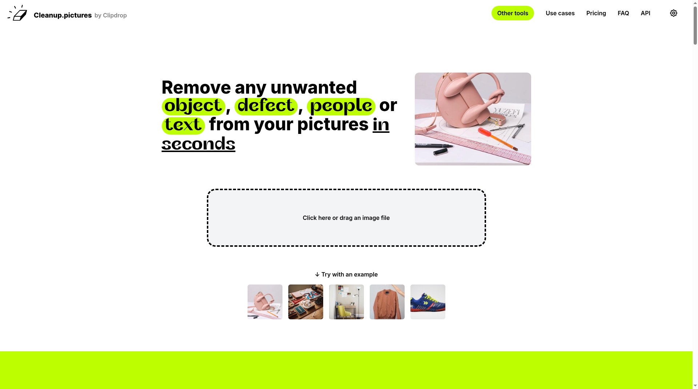
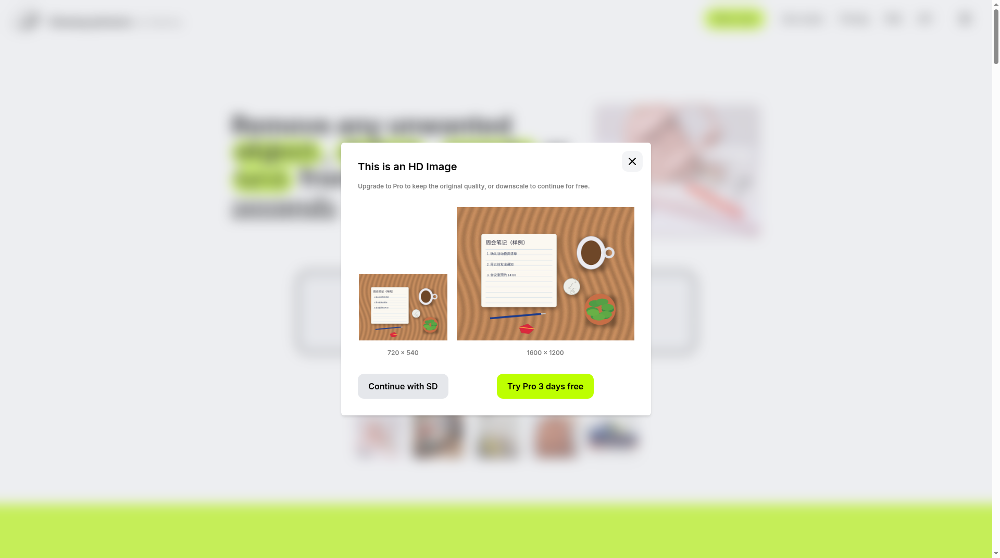
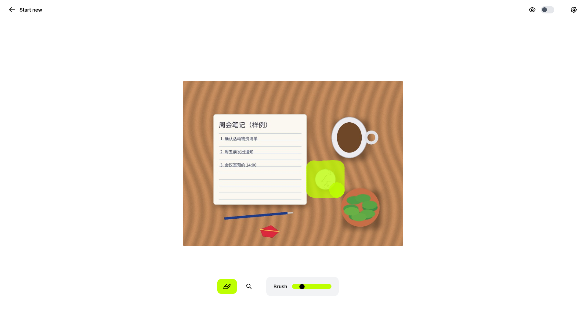
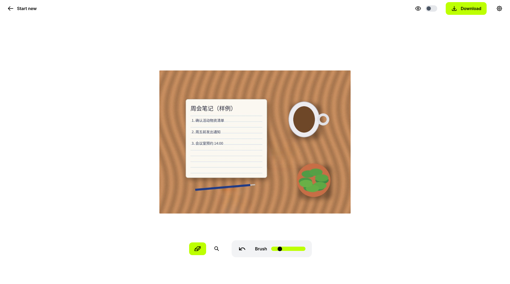
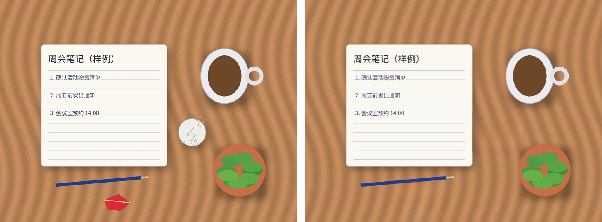
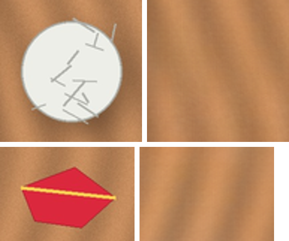

# AI 消除图片多余物体免费在线：用 Cleanup.pictures 涂一涂去掉杂物（实测）

照片拍得不错，桌上却多了个纸团，或者角落有张糖纸，很多人第一反应是装修图软件。其实现在有网页版的 AI 消除工具：把不想要的东西用画笔涂一下，AI 会按周围的背景把那块补上。这篇按本机实测，走通 Cleanup.pictures：不用注册，不用付费，涂一涂就能消掉，再下载结果。

这篇只写消除画面里多出来的杂物，不写去水印，也不处理证件照和人脸。

测试时间是 2026 年 11 月 28 日 12:14–12:16（曼谷时间）。样张是我们自己画的一张虚构桌面图 `ai-erase-desk.jpg`，1600 × 1200 像素：木纹桌面上有一本「周会笔记（样例）」、一杯咖啡、一盆绿植和一支蓝色笔。要消掉的两个杂物，是我们特意放上去的：中间偏右一个白色「纸团」，下方一张红色「糖纸」。图里没有任何人脸或个人隐私。

## 结论速查

1. 打开 [Cleanup.pictures](https://cleanup.pictures/)，点上传框「Click here or drag an image file」选图。
2. 如果图片比较大，会弹出「This is an HD Image」。点「Continue with SD」走免费版（图会被缩小）；另一个按钮「Try Pro 3 days free」是付费试用，本机没有点。
3. 用画笔把要消除的东西整个涂满，稍微超出边缘一点，松开鼠标后 AI 会自动补上背景。
4. 每消掉一处可以接着涂下一处，全部消完后点「Download」下载。

## 适合谁

- 照片里多了垃圾、杂物、路人放下的小东西，想去掉再发朋友圈或放进文档的人；
- 不想学修图软件、也不想为一次小修开会员的人。

文件会上传到对方的服务器。网站界面是英文的，但按钮不多，照着下面的步骤点就行。

## 用到的工具和费用

- 工具：[Cleanup.pictures](https://cleanup.pictures/)（页面上写着 Cleanup.pictures by Clipdrop）
- 全程没有登录，没有付费，也没有填邮箱或手机号。
- 这次只用了免费版。上传大图时弹窗写明：免费继续会把图缩小（本次是 720 × 540），要保留原图大小需要升级 Pro。

## 实际怎么操作

打开网站，点上传框「Click here or drag an image file」，选中样张。因为这张图是 1600 × 1200，页面弹出「This is an HD Image」，写着「Upgrade to Pro to keep the original quality, or downscale to continue for free.」左边是缩小后的「720 x 540」和按钮「Continue with SD」，右边是原图「1600 x 1200」和「Try Pro 3 days free」。本机点了「Continue with SD」，继续用免费版。

进入编辑界面后，下方有「Brush」画笔粗细滑条。本机用默认粗细，按住鼠标在纸团上来回拖，把整个纸团涂满，边缘稍微多涂一点。涂过的地方会先盖上一层颜色，松开鼠标后就开始消除。

纸团涂 1 次就消掉了。接着用同样的方法涂下方的红色糖纸，也是 1 次就消掉了。消完以后，界面上出现了「Download」按钮，点它就直接下载，没有弹出选项，也没有要求登录或付费。

## 实测结果

下载到的文件名是 `ai-erase-desk_cleanup.jpg`，大小是 480,529 字节，图片是 720 × 540 像素，不是原图的 1600 × 1200。另外，这个文件扩展名虽然是 `.jpg`，本机检查它实际是 PNG 格式；一般看图和发送不受影响，如果某个网站只收真正的 JPG，可以先转换一下格式。

下面左边是原图（为了对比，本机把它缩到和结果一样的 720 × 540），右边是下载到的结果。纸团和它下面的阴影、红色糖纸都不见了，那两块补成了木纹桌面；笔记本上的文字、杯子、绿植和蓝色笔都还在，没有被改动。

再把两处放大看（上面是纸团，下面是糖纸，左边消除前，右边消除后）。这张样张的背景是比较规整的木纹，补出来的纹理和周围接得上。

这只说明这一张样张、这两个杂物的效果。我们放上去的杂物边缘清楚，背景也简单；换成实拍照片、杂物压在复杂图案上、或者杂物很大时，补出来的地方可能会糊、会对不上纹理，不能保证看不出痕迹。下载后一定要自己放大看一下。

## 使用时要注意

- 文件会上传到对方的服务器。含真实人脸、证件、聊天记录或住址的照片，先想清楚要不要上传。
- 免费继续时大图会被缩小再处理（本次 1600 × 1200 缩到 720 × 540），下载的也是缩小后的图。要保留原图大小，页面给的是付费 Pro，本机没有试。如果之后要放大，那是另一步。
- 只涂你真正要去掉的东西，不要涂到旁边的主体上。
- 这次没有收费，这是当天操作时的情况，以后如果改了规则，以当时页面为准。
- 不要用这类工具去掉别人图片上的水印或版权标记。

## 本机没有测的部分

- 没有测实拍照片、人像或复杂背景；
- 没有测 Pro 版和原图分辨率；
- 没有测去掉很大的物体或文字；
- 界面上有一个像前后对比的开关，本机按了没有看到画面变化，所以这里没有用它；
- 没有在手机浏览器里重复操作，按钮名称以你当天打开的页面为准。

如果消完以后觉得图小了，可以看本站已经写过的 [免费 AI 放大图片：用 iLoveIMG 把低分辨率照片按 2 倍放大（实测）](https://www.mmfei.com/2026/11/免费ai放大图片iloveimg/)；想把图片再压小一点，可以看 [在线压缩图片免费：用 iLoveIMG 把偏大的照片压小（实测）](https://www.mmfei.com/2026/11/在线压缩图片免费iloveimg/)。不要把这篇里的体积或像素套到那两篇上。

