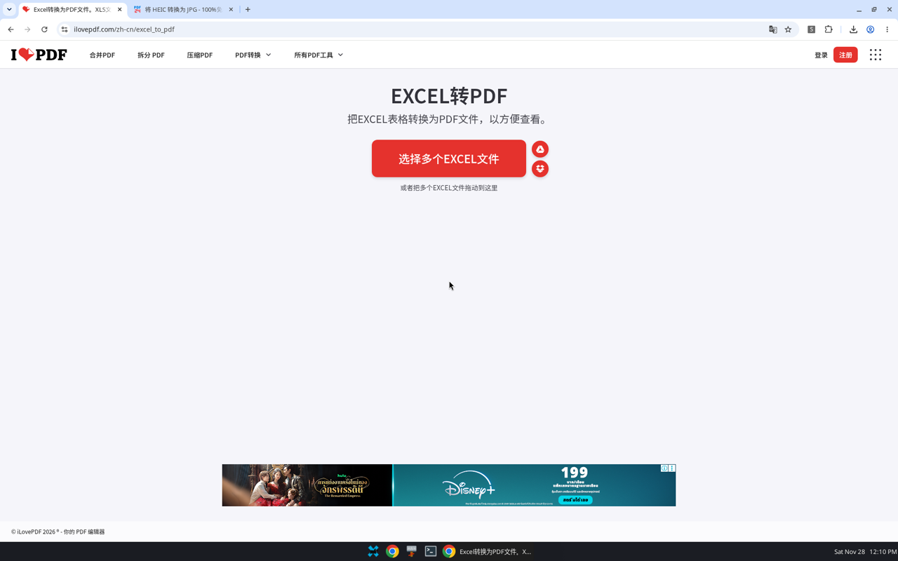
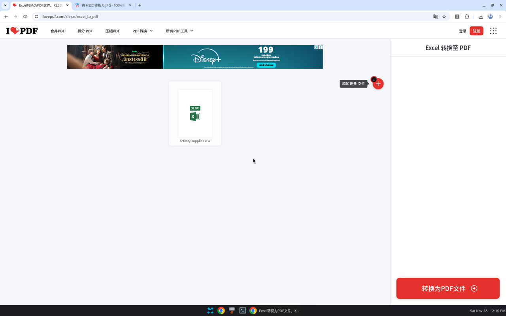
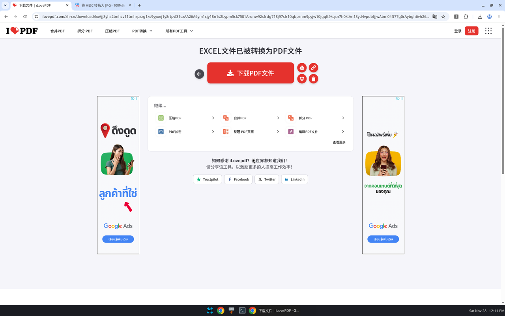
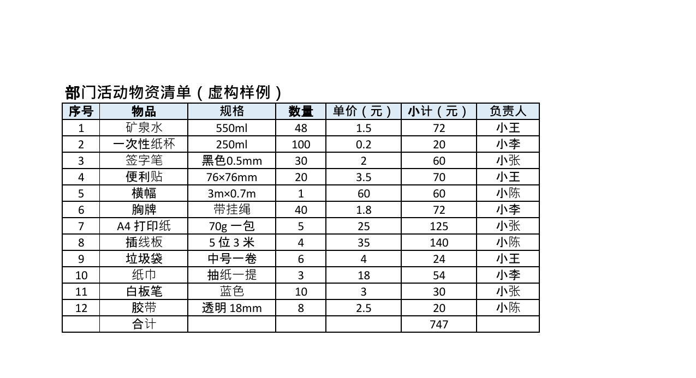

# Excel 转 PDF 免费在线：用 iLovePDF 把表格转成 PDF（实测）

做好的 Excel 表格，直接发给别人，对方电脑上可能没有 Excel，或者打开后格式跑掉。转成 PDF 再发，对方打开看到的版面就固定了。这篇按本机实测，走通 iLovePDF 的在线转换：不用注册，不用付费，上传一份 xlsx，按默认设置就能下载到 PDF。

这篇只写把 Excel 表格转成 PDF，不是把 Word 转成 PDF，也不是把图片或 PDF 转回 Excel。

测试时间是 2026 年 11 月 28 日 12:10–12:11（曼谷时间）。样例文件是我们自己做的 `activity-supplies.xlsx`，一张虚构的「部门活动物资清单（虚构样例）」，共 7 列（序号、物品、规格、数量、单价、小计、负责人）、15 行（标题、表头、12 行物品和一行合计），每个单元格都有细边框，表头有浅蓝底色，「小计」和「合计」是公式。表里没有任何个人隐私。

## 结论速查

1. 打开 [iLovePDF Excel 转 PDF](https://www.ilovepdf.com/zh-cn/excel_to_pdf)。
2. 点「选择多个EXCEL文件」，上传要转换的表格。也可以把文件拖到页面上。
3. 上传后右侧栏只有标题「Excel 转换至 PDF」，这次没有看到纸张方向、纸张大小或缩放到一页之类的选项，直接点「转换为PDF文件」。
4. 出现「EXCEL文件已被转换为PDF文件」后，这次 PDF 已经自动下载；页面上也有「下载PDF文件」按钮。

## 适合谁

- 要把报价单、物资清单、排班表这类表格发给别人，希望对方打开版面不变的人；
- 电脑上没装 Excel，或者不想为此开会员、装软件的人。

文件会上传到对方的服务器。含真实工资、客户、手机号或身份证号的表格，先想清楚要不要上传。

## 用到的工具和费用

- 工具：[iLovePDF Excel 转 PDF](https://www.ilovepdf.com/zh-cn/excel_to_pdf)
- 全程没有登录，没有付费，也没有填邮箱或手机号。右上角一直有「登录」和「注册」，但没有要求必须使用。
- 上传后的页面和结果页都有广告分区，本机没有点。结果页的「继续...」里有压缩、合并、拆分 PDF 等入口，本机也没有点。

## 实际怎么操作

打开上面的地址，页面标题是「EXCEL转PDF」，下面写着「把EXCEL表格转换为PDF文件，以方便查看。」点「选择多个EXCEL文件」，选中要转换的 xlsx。本机只上传了这一份样例，没有测一次传多份。

上传后，页面上出现文件卡片 `activity-supplies.xlsx`，右侧栏标题是「Excel 转换至 PDF」，下面是空的，没有可以改的设置。点右下角的「转换为PDF文件」。

完成后，结果页显示「EXCEL文件已被转换为PDF文件」，有「下载PDF文件」按钮。这次结果页上没有写文件大小和页数；转换完成后，PDF 已经自动出现在下载目录里，没有再要求登录。

## 实测结果

下载到的文件名是 `activity-supplies.pdf`，大小是 188,472 字节，共 1 页，纸张是 Letter（612 × 792 pt），不是国内常用的 A4。

本机打开后核对：7 列都在，最右边的「负责人」没有被截断，也没有被挤到第二页；15 行都在；每个单元格的细边框、表头的浅蓝底色都保留了；公式算出的小计和合计「747」也正常显示，不是公式原文。表格靠左上排在页面里，页面下半部分是空白。

这次没有看到额外加上的水印文字，但不保证其他文件、其他时间也不会出现。「转出来正好一页」只对这份 7 列、15 行的小表成立：列更多、行更多的表格，可能会分成好几页，或者一页放不下的列被分到后面的页。转完一定要自己打开 PDF，看列有没有被切开、页数对不对。

## 使用时要注意

- 文件会上传到 iLovePDF 的服务器，不要上传含真实工资、客户资料或证件号码的表格。
- 这次网页上没有纸张大小、方向或「缩放到一页」的选项。纸张是 Letter 而不是 A4，本机没有测在表格里先设好 A4 再上传会不会跟着变。
- 这次没有收费，页面上有广告。这是当天操作时的情况，以后如果改了规则，以当时页面为准。
- 如果转出来的 PDF 偏大，想再压小，是另一步，不要和转换混在一起。

## 本机没有测的部分

- 没有测 Excel 或 WPS 自带的「另存为 PDF / 输出为 PDF」；
- 没有测多个工作表（sheet）的表格怎么分页；
- 没有测几十列的宽表或几千行的长表；
- 没有测 .xls 老格式和 .csv；
- 没有在手机浏览器里重复操作，按钮名称以你当天打开的页面为准。

如果你要转的是 Word 文档，可以看本站已经写过的 [Word 转 PDF 免费在线：用 iLovePDF 把文档转成可分发的 PDF（实测）](https://www.mmfei.com/2026/11/word转pdf免费在线ilovepdf/)；转完想把 PDF 压小，可以看 [PDF 压缩免费在线：用 PDF24 把偏大的文件压小再发送（实测）](https://www.mmfei.com/2026/11/pdf压缩免费在线pdf24/)。

