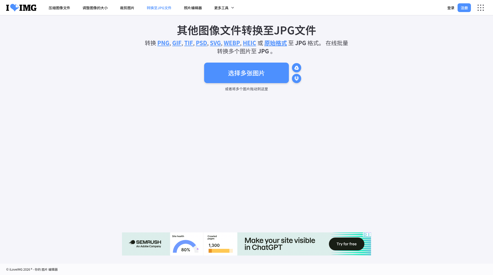
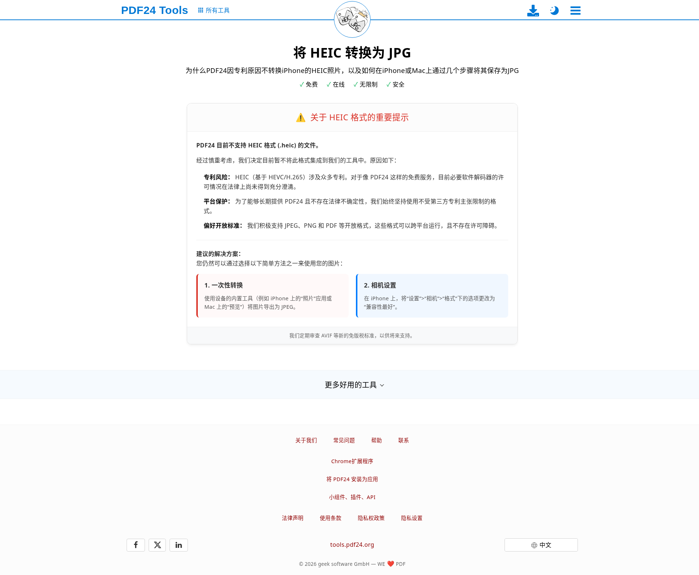
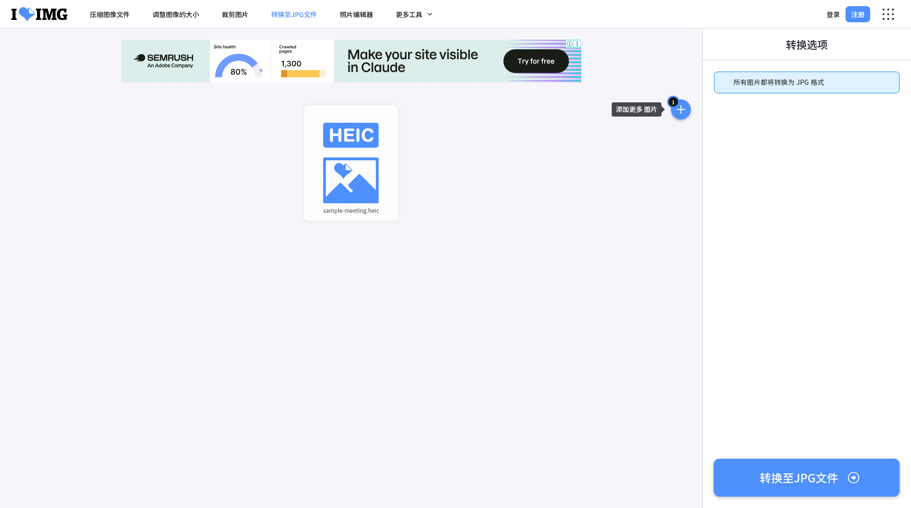
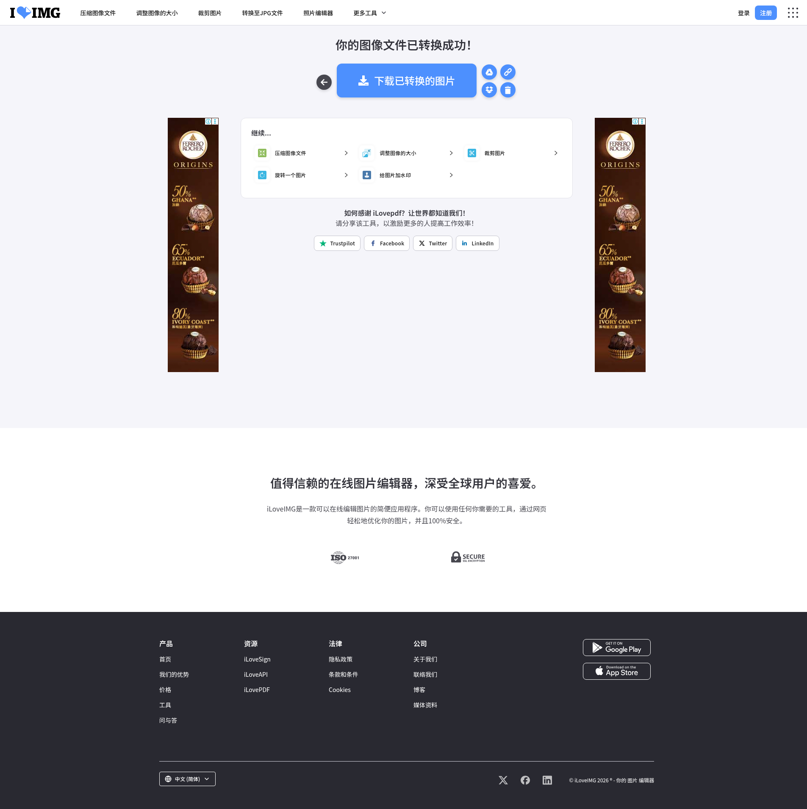
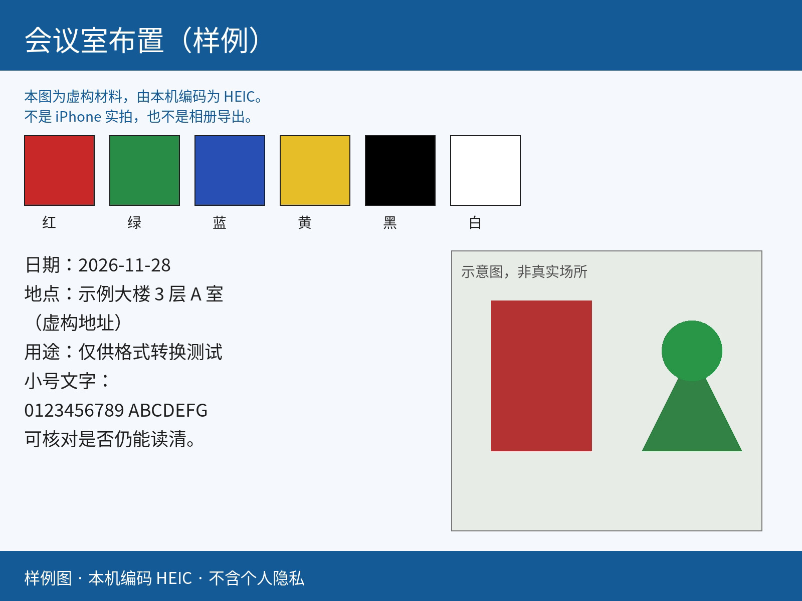

# HEIC 转 JPG 免费在线：用 iLoveIMG 把 HEIC 转成普通图片（实测）

iPhone 拍出来的照片常常是 HEIC，拿到 Windows 或网页上，有时不能直接打开。这篇按本机实测，走通 iLoveIMG 的在线转换：不用注册，不用付费，按页面默认选项就能把一份真实编码的 HEIC 转成 JPG。标题、色块和小号文字仍然能读清。

这次上传的不是 iPhone 实拍，也不是从苹果「照片」或相册里导出的文件，而是我们自己做的一张虚构示意图，在本机编码成 HEIC。所以这篇只说明这份样张在网页上能转、转完仍可读，不能写成已经用苹果相册或实拍照片测过，也不承诺无损。

这篇只写把 HEIC 转成 JPG，不是把 JPG、PNG 或 WebP 批量转格式的百科，也不是改 iPhone 相机默认格式的教程。

测试时间是 2026 年 11 月 28 日 09:42–09:44（曼谷时间）。样例文件名是 `sample-meeting.heic`，按文件字节数是 131,511 字节，画面是 1600 × 1200，标题是「会议室布置（样例）」。本机核对过，它是 HEVC 编码的 HEIC（文件主品牌为 heic），不是把 JPG 改了个扩展名。图里没有个人隐私，也没有 HDR。

## 结论速查

1. 打开 [iLoveIMG 转换为 JPG](https://www.iloveimg.com/zh-cn/convert-to-jpg)。
2. 点「选择多张图片」，上传要转换的 HEIC。也可以把文件拖到页面上。
3. 右侧「转换选项」里，这次只看到一句「所有图片都将转换为 JPG 格式」，没有质量、尺寸或水印开关。本机没有改任何选项。
4. 点「转换至JPG文件」。出现「你的图像文件已转换成功！」后，这次已经自动下载到一张 JPG；页面上也有「下载已转换的图片」。

## 适合谁

- 拿到一份 HEIC，想在 Windows 或网页里用更常见的 JPG 打开、发送的人；
- 不想为此开会员、也不想先装软件的人。

文件会上传到对方的服务器。实拍照片、证件、聊天记录或含人脸、住址的图片，先想清楚要不要上传。敏感文件更适合在你自己的电脑里转换，这篇不展开离线方案。

## 用到的工具和费用

- 工具：[iLoveIMG 转换为 JPG](https://www.iloveimg.com/zh-cn/convert-to-jpg)
- 全程没有登录，没有付费。顶栏一直有「登录」和「注册」，但没有要求必须使用，也可以直接下载。
- 工具页、上传后的页面和结果页上有广告分区。结果页没有看到必须付费才能下载的提示。结果页的「继续...」里有「压缩图像文件」「调整图像的大小」等入口，本机没有点。

本机先打开过 [PDF24 将 HEIC 转换为 JPG](https://tools.pdf24.org/zh/heic-to-jpg)。那个页面写明，因专利原因目前不支持 HEIC（.heic）文件，也没有上传和转换入口，所以这次没有用它完成转换，改走上面已经走通的 iLoveIMG。

## 实际怎么操作

打开上面的地址后，页面标题是「其他图像文件转换至JPG文件」。下面写着可以转换「PNG, GIF, TIF, PSD, SVG, WEBP, HEIC 或 原始格式」到 JPG，并提到可以在线批量转换。点「选择多张图片」，选中要转换的 HEIC。本机只上传了上面那一份虚构样张，没有测一次选多张。

上传后，页面接受了这份 `.heic` 文件，文件名显示为 `sample-meeting.heic`，卡片上有 HEIC 标识。右侧栏标题是「转换选项」，可见的说明只有一句「所有图片都将转换为 JPG 格式」。这次没有看到质量、尺寸或水印开关。本机全部保持默认，然后点「转换至JPG文件」。

完成后，结果页会显示「你的图像文件已转换成功！」。这次结果页上没有写出文件大小、分辨率，也没有写会不会加水印。页面上有「下载已转换的图片」按钮；这次转换完成后，一张 JPG 已经自动出现在下载目录里，没有再要求登录。

## 实测结果

下载到的文件名是 `sample-meeting.jpg`，大小是 175,461 字节，不是 ZIP。本机打开后，这张图是 1600 × 1200 像素，和原 HEIC 的画面尺寸一致。标题「会议室布置（样例）」、红绿蓝黄黑白六块色标、「0123456789 ABCDEFG」和「可核对是否仍能读清。」都还能读清，页脚「样例图 · 本机编码 HEIC · 不含个人隐私」也还在。

这次打开的图片里，没有看到额外加上的水印文字，但不保证其他文件、其他时间也不会出现水印。这是按页面默认选项得到的结果，只说明这次样例的标题和正文仍可读，像素仍是 1600 × 1200，不能写成「无损」或「完全不失真」，也不能写成可以指定任意分辨率。这份样张本身没有 HDR，本机也没有测带 HDR 的实拍照片；换一张实拍、夜景或人像，观感可能不一样。转换完成后，请自己打开图片，核对画面和文字。

## 使用时要注意

- 文件会上传到 iLoveIMG 的服务器，不要上传含真实证件、实拍人脸、聊天记录或住址信息的照片。
- 这次没有收费，页面上有广告。这是当天操作时的情况，以后如果改了规则，以当时页面为准。
- 这次只传了一张，下载也是单张 JPG。页面按钮写的是「选择多张图片」，一次转很多张会不会打成 ZIP，本机没有测。
- 结果页的「继续...」会引导去做压缩、调整大小、裁剪或加水印，那是另一步，不要和「把 HEIC 转成 JPG」混在一起。

## 本机没有测的部分

- 没有用 iPhone 实拍、苹果「照片」或 Mac「预览」做转换；
- 没有测带 HDR 的照片；
- 没有一次上传多张 HEIC；
- 没有打开 iLoveIMG 文案里 HEIC 链到的专用路径，也没有把已确认 404 的 `/zh-cn/heic-to-jpg` 当作入口；
- 没有在 Windows 或手机浏览器里重复操作，按钮名称以你当天打开的页面为准；
- 没有测特别大的文件。

如果转完以后还想把 JPG 压小一点，可以参考本站已经写过的 [在线压缩图片免费：用 iLoveIMG 把偏大的照片压小（实测）](https://www.mmfei.com/2026/11/在线压缩图片免费iloveimg/)。不要把这篇里的体积或像素套到那一篇上。

