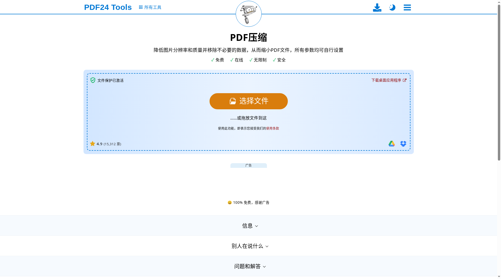
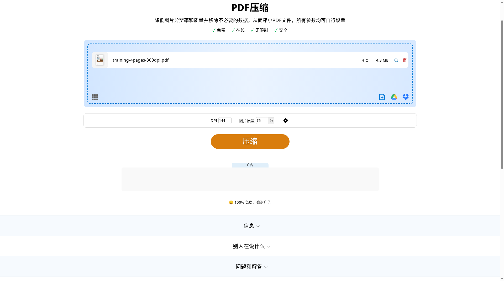
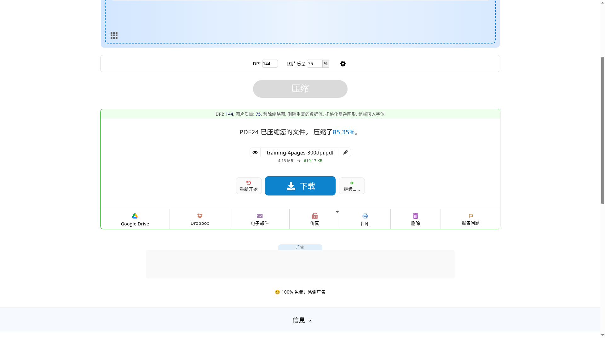
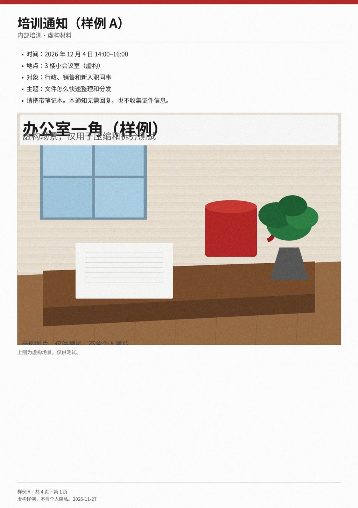
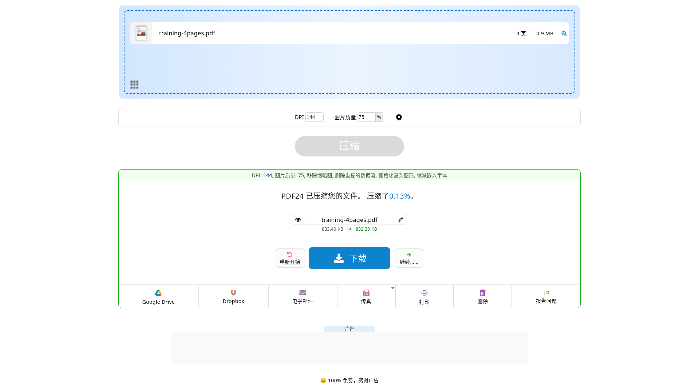

# PDF 压缩免费在线：用 PDF24 把偏大的文件压小再发送（实测）

要把一份十几页的扫描件、培训材料或带图说明发到邮箱，最常见的拦路虎就是附件上限，很多人会搜「PDF 压缩到 2MB 以下」。这篇按本机实测，走通 PDF24 的在线压缩：不用注册，不用付费，默认档就能把一份 4.13MB 的 4 页材料压到 619.17KB，页序和正文都还在。

测试时间是 2026 年 11 月 27 日 09:34–09:46（曼谷时间）。样例是我们自己做的虚构培训材料，不含个人隐私。

## 结论速查

1. 打开 [PDF24 在线压缩](https://tools.pdf24.org/zh/compress-pdf)。
2. 点「选择文件」，上传要压缩的 PDF。
3. 如无特殊要求，保持默认的 DPI 144、图片质量 75%，点「压缩」。
4. 等到出现「PDF24 已压缩您的文件。」和压缩比例后，点「下载」。

## 适合谁

- 要把偏大的 PDF 发出去，被邮箱或网盘的 2MB、10MB 上限拦住的人；
- 不想为此开会员、也不想先装软件的人。

如果你的文件里有合同、证件或发票，请先想清楚：在线工具会把文件上传到对方的服务器。敏感文件更适合用本机软件离线压缩，这篇不展开离线方案。

这份样例本身已经小于很多网盘的上限，但大于常见的 2MB 邮箱限制，所以用来验证「压到 2MB 以下」是否做得到。不同文件的压缩幅度会差很多，下文也写了几乎压不动的情况。

## 用到的工具和费用

- 工具：[PDF24 Tools 在线压缩 PDF](https://tools.pdf24.org/zh/compress-pdf)
- 页面上写着「✓ 免费 ✓ 在线 ✓ 无限制 ✓ 安全」，以及「100% 免费，感谢广告」。
- 全程没有登录，没有付费，下载下来的文件也没有水印。
- 页面上有一句「使用此功能，即表示您接受我们的使用条款」，上传区下方有广告分区。

同一类网页工具还有别的站点，这次 PDF24 已经走通，就没有再测其他网站。换工具时，请自己看清有没有登录或付费才能下载。

## 实际怎么操作

打开上面的地址后，点「选择文件」，选中要压缩的 PDF。本机上传的是一份 4 页虚构培训材料 `training-4pages-300dpi.pdf`，列表视图里显示 4 页、4.3MB（按文件字节数是 4,326,770 字节，约 4.13MB）。这份材料按 300DPI 做成图片页，用来模拟「扫描得很清晰、但发邮件嫌大」的常见情况。

页面上可以改两个常用参数：

- DPI：默认 144。
- 图片质量：默认 75%。

本机没有改这两项，也没有打开「更多选项」。然后点「压缩」。完成后，结果页会显示「PDF24 已压缩您的文件。 压缩了85.35%。」并回显实际使用的参数：DPI 144、图片质量 75%，以及默认勾选的「移除缩略图」「删除重复的数据流」「栅格化复杂图形」「缩减嵌入字体」。再点「下载」即可保存到电脑。

## 实测结果

| 项目 | 大小 | 页数 |
| --- | --- | --- |
| 压缩前 | 4,326,770 字节（约 4.13MB） | 4 页，A4 |
| 压缩后 | 634,031 字节（619.17KB） | 4 页，A4 |

体积减少约 85.35%，已经低于常见的 2MB 邮箱附件上限。下载文件的默认名仍是原来的 `training-4pages-300dpi.pdf`。

打开压缩后的第 1 页，标题「培训通知（样例 A）」、时间地点等条目、图注和页脚「样例 A · 共 4 页 · 第 1 页」都还在，后续 3 页的页脚页码也还在，没有发现 PDF24 水印。因为默认会把 300DPI 降到 144DPI，画面和原件比会有一些重压缩痕迹，但在正常阅读距离下文字仍然清楚，不影响认字。

## 如果几乎压不下去

不是每一份 PDF 都会明显变小。本机另外测过一份同样 4 页、但本身已经接近 150DPI、体积只有 853,405 字节（833.40KB）的材料，用完全相同的默认档，结果只变成 852,274 字节（832.30KB），页面显示「压缩了 0.13%」。

如果文件主要是已经压缩过的图片，或分辨率本来就接近默认的 144DPI，再压一次就不会有明显收益。这时可以先看页面上的结果比例；若仍超过邮箱上限，再考虑把 DPI 或图片质量调低，并自己检查文字是否还清楚。本机在 4.13MB 这份样例上，默认档已经低于 2MB，因此没有再测更低档位。

## 使用时要注意

- 文件会上传到 PDF24 的服务器，不要上传含身份证、银行卡、未公开合同等敏感内容。
- 页面写的是免费、无限制，并以广告支持。这是当天页面上的原文，以后如果改了收费规则，以当时页面为准。
- 压缩会降低图片分辨率或质量。文字为主的页面通常仍可读；把扫描件压得很低时，请先打开结果看清字。
- 本机没有测试加密 PDF，也没有测试特别大的文件。如果某个文件打不开，先确认它本身有没有密码。

## 本机没有测的部分

- 没有测 iLovePDF 或其他压缩网站；
- 没有把 DPI、图片质量调到更低档，也没有勾选「转换为灰度」等高级选项；
- 没有在 Windows 或手机浏览器里重复操作，按钮名称以你当天打开的页面为准。

如果你接下来要把压好的文件按页拆开，或者只把其中几页发给别人，可以另看拆分的做法。若要把多份文件先合成再压缩，可参考本站已经写过的 [PDF 合并免费在线：用 PDF24 把多个文件合成一个（实测）](https://www.mmfei.com/2026/11/pdf合并免费在线pdf24/)。

