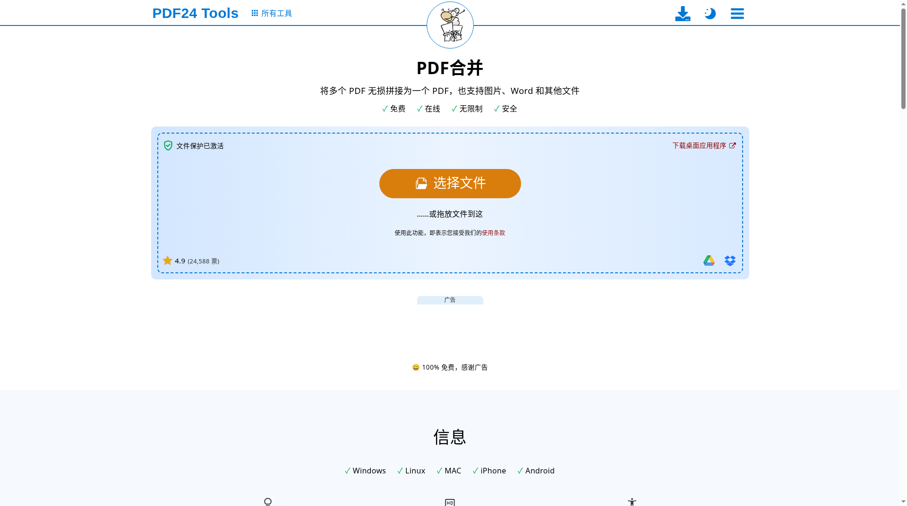
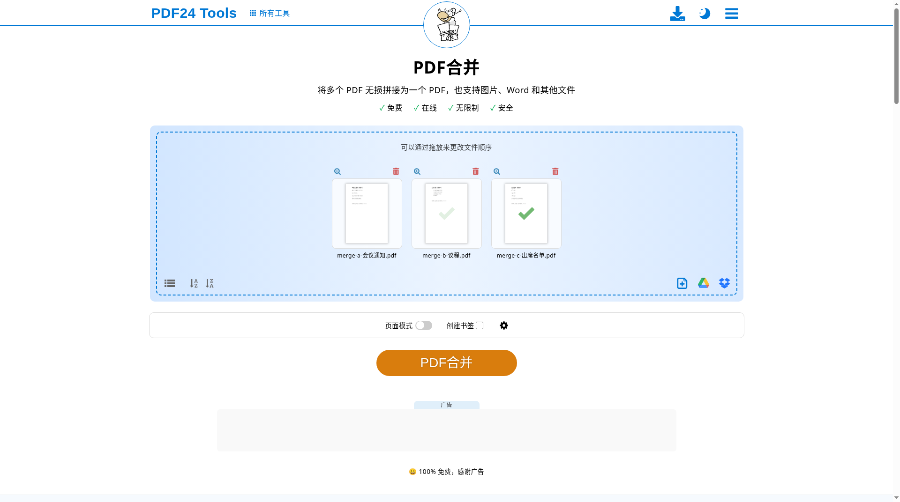
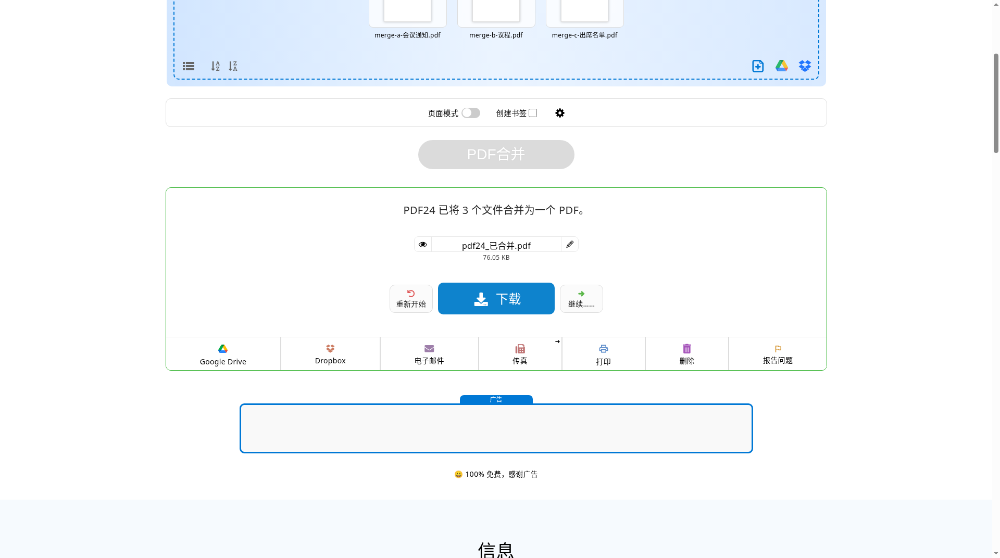

# PDF 合并免费在线：用 PDF24 把多个文件合成一个（实测）

报销要把发票和行程单合成一份，投标要把报价、说明和附件按顺序拼起来，最常见的需求就是「找一个免费的网页，把几个 PDF 合成一个」。这篇按本机实测，走通 PDF24 的在线合并：不用注册，不用付费，合并后的页序也是对的。

测试时间是 2026 年 11 月 26 日 09:42–09:44（曼谷时间）。样例是我们自己做的虚构会议材料，不含个人隐私。

## 结论速查

1. 打开 [PDF24 在线合并](https://tools.pdf24.org/zh/merge-pdf)。
2. 点「选择文件」，一次选中要合并的多个 PDF，等缩略图都出来。
3. 点橙色的「PDF合并」，等到出现「PDF24 已将 3 个文件合并为一个 PDF。」
4. 点「下载」，得到合成后的文件。

## 适合谁

- 偶尔要把几份 PDF 合成一份，不想为此开会员的人；
- 电脑上暂时装不了软件，只想在网页里做完的人。

如果你的文件里有合同、证件或发票，请先想清楚：在线工具会把文件上传到对方的服务器。敏感文件更适合用本机软件离线合并，这篇不展开离线方案。

## 用到的工具和费用

- 工具：[PDF24 Tools 在线合并 PDF](https://tools.pdf24.org/zh/merge-pdf)
- 实测当天页面上写着「✓ 免费 ✓ 在线 ✓ 无限制 ✓ 安全」，以及「100% 免费，感谢广告」。
- 全程没有登录，没有付费，下载下来的文件也没有水印。
- 页面上有一句「使用此功能，即表示您接受我们的使用条款」，没有另外弹出 Cookie 同意框。

同一类网页工具还有别的站点，这次 PDF24 已经走通，就没有再测其他网站。换工具时，请自己看清有没有登录或付费才能下载。

## 实际怎么操作

打开上面的地址后，点「选择文件」，把要合并的 PDF 都选上。本机上传了 3 个虚构样例：会议通知、议程、出席名单。文件上传后，页面上会出现缩略图，等全部就绪再点合并。

然后点橙色的「PDF合并」。完成后，结果页会显示「PDF24 已将 3 个文件合并为一个 PDF。」默认文件名是 `pdf24_已合并.pdf`，本机下载大小是 76.05 KB。再点「下载」即可保存到电脑。

上传前可以在页面里调整文件顺序。本机没有改顺序，按选择时的顺序合并。

## 实测结果

合并后的 PDF 一共 3 页，页序正确，正文完整，没有水印：

- 第 1 页：周例会通知（样例 A）
- 第 2 页：会议议程（样例 B）
- 第 3 页：出席名单（样例 C）

## 使用时要注意

- 文件会上传到 PDF24 的服务器，不要上传含身份证、银行卡、未公开合同等敏感内容。
- 页面写的是免费、无限制，并以广告支持。这是当天页面上的原文，以后如果改了收费规则，以当时页面为准。
- 本机没有测试特别大的文件，也没有测试加密 PDF。如果某个文件打不开，先确认它本身有没有密码。

## 本机没有测的部分

- 没有测 iLovePDF 或其他合并网站；
- 没有在 Windows 或手机浏览器里重复操作，按钮名称以你当天打开的页面为准。

