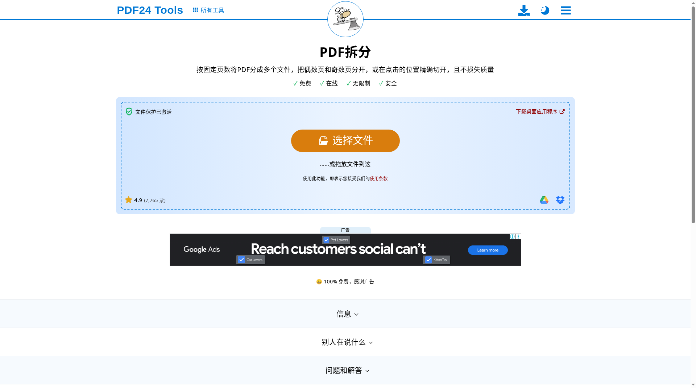
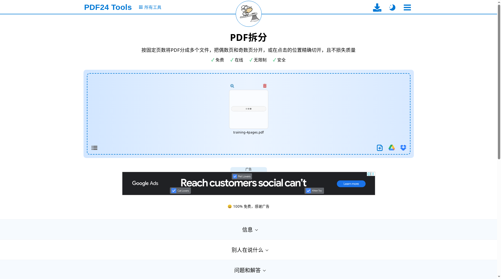
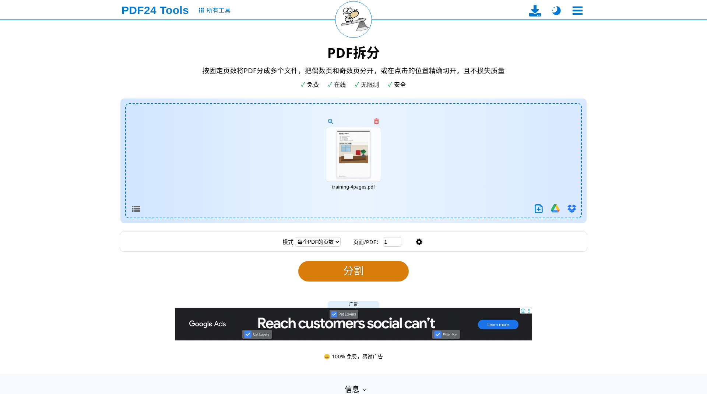
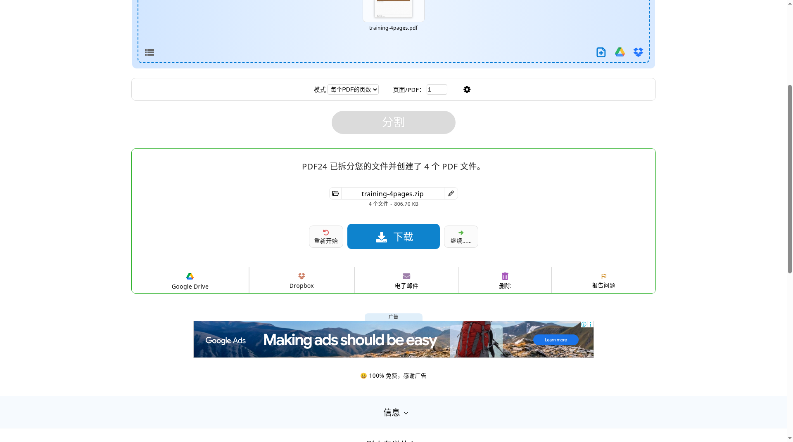
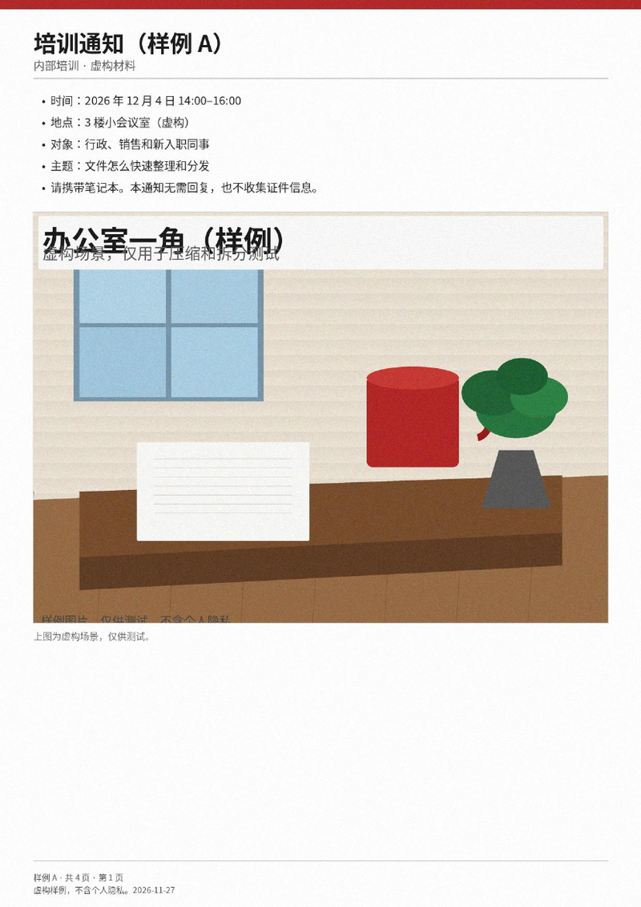

# PDF 拆分免费在线：用 PDF24 把一份文件按页拆开（实测）

要把一份多页的培训材料、扫描件或说明文档按页分开存档，或者只把其中几页发给别人，很多人会搜「PDF 拆分成单页」。这篇按本机实测，走通 PDF24 的在线拆分：不用注册，不用付费，默认按「每个 PDF 1 页」就能把一份 4 页材料拆成 4 个单页文件，页序、标题和页脚都还在。

测试时间是 2026 年 11 月 27 日 16:56–17:03（曼谷时间）。样例是我们自己做的虚构培训材料，不含个人隐私。

## 结论速查

1. 打开 [PDF24 在线拆分](https://tools.pdf24.org/zh/split-pdf)。
2. 点「选择文件」，上传要拆开的 PDF。
3. 如无特殊要求，保持默认模式「每个PDF的页数」，「页面/PDF」填 1，点「分割」。
4. 等到出现「PDF24 已拆分您的文件并创建了 4 个 PDF 文件。」后，点「下载」，会得到一个包含各单页的 zip。

## 适合谁

- 要把一份多页 PDF 拆成单页，或按页分别发给不同的人；
- 不想为此开会员、也不想先装软件的人。

如果你的文件里有合同、证件或发票，请先想清楚：在线工具会把文件上传到对方的服务器。敏感文件更适合用本机软件离线拆分，这篇不展开离线方案。

## 用到的工具和费用

- 工具：[PDF24 Tools 在线拆分 PDF](https://tools.pdf24.org/zh/split-pdf)
- 页面上写着「✓ 免费 ✓ 在线 ✓ 无限制 ✓ 安全」，以及「100% 免费，感谢广告」。页面副标题还写着「按固定页数将PDF分成多个文件，把偶数页和奇数页分开，或在点击的位置精确切开，且不损失质量」。
- 全程没有登录，没有付费，下载下来的单页里也没有看到 PDF24 水印。
- 页面上有一句「使用此功能，即表示您接受我们的使用条款」，上传区下方有广告分区。

同一类网页工具还有别的站点，这次 PDF24 已经走通，就没有再测其他网站。换工具时，请自己看清有没有登录或付费才能下载。

## 实际怎么操作

打开上面的地址后，点「选择文件」，选中要拆开的 PDF。本机上传的是一份 4 页虚构培训材料 `training-4pages.pdf`，按文件字节数是 853,405 字节（833.40KB），页面为 A4。

上传完成后，页面会出现模式和页数选项。本机保持默认：模式为「每个PDF的页数」，「页面/PDF」为 1，也就是每个新文件只放 1 页。然后点「分割」。本机没有改其他模式，也没有测只提取其中某一页。

完成后，结果区会显示「PDF24 已拆分您的文件并创建了 4 个 PDF 文件。」文件名是 `training-4pages.zip`，并标明「4 个文件 - 806.70 KB」。页面还提供 Google Drive、Dropbox、电子邮件等可选去向，本机没有使用，直接点「下载」。

点「下载」后，页面会提示「下载已开始。请查看下载文件夹。」本机随后在下载目录里拿到了这个 zip，没有登录或付费墙。

## 实测结果

| 项目 | 大小 | 页数 |
| --- | --- | --- |
| 拆分前 | 853,405 字节（833.40KB） | 4 页，A4 |
| 下载的 zip | 826,056 字节（页面显示 806.70 KB） | 内含 4 个文件 |
| training-4pages-1.pdf | 213,388 字节 | 1 页，A4 |
| training-4pages-2.pdf | 209,659 字节 | 1 页，A4 |
| training-4pages-3.pdf | 215,146 字节 | 1 页，A4 |
| training-4pages-4.pdf | 217,202 字节 | 1 页，A4 |
| 四个单页合计（未压缩） | 855,395 字节 | 4 × 1 页 |

zip 里的四个文件正好对应原来的第 1 到第 4 页。打开第 1 页，标题「培训通知（样例 A）」、时间地点等条目、图注和页脚「样例 A · 共 4 页 · 第 1 页」都还在；第 2 到第 4 页分别是培训议程（样例 B）、物料清单（样例 C）、注意事项（样例 D），页脚页码也还在，没有发现 PDF24 水印。本机按 72 dpi 把拆开后的页面和原件对应页对照，像素没有差异。

注意：拆开后的单页页脚仍写着「共 4 页」，这是原文件上印好的页码，不是拆分工具新加的。四个单页的体积加在一起和原件接近，拆分主要是把页面分开，并不等于把文件压小。

## 使用时要注意

- 文件会上传到 PDF24 的服务器，不要上传含身份证、银行卡、未公开合同等敏感内容。
- 页面写的是免费、无限制，并以广告支持。这是当天页面上的原文，以后如果改了收费规则，以当时页面为准。
- 本机测的是按每文件 1 页拆开整份文档。没有测加密 PDF，也没有测特别大的文件。如果某个文件打不开，先确认它本身有没有密码。

## 本机没有测的部分

- 没有测 iLovePDF 或其他拆分网站；
- 没有测只提取其中某一页，也没有把「页面/PDF」改成其他数字，或使用页面上的其他拆分模式；
- 没有在 Windows 或手机浏览器里重复操作，按钮名称以你当天打开的页面为准。

如果你接下来要把拆好的单页再和其他文件合并，可参考本站已经写过的 [PDF 合并免费在线：用 PDF24 把多个文件合成一个（实测）](https://www.mmfei.com/2026/11/pdf合并免费在线pdf24/)。若只是文件太大发不出去，可以另看压缩的做法。

