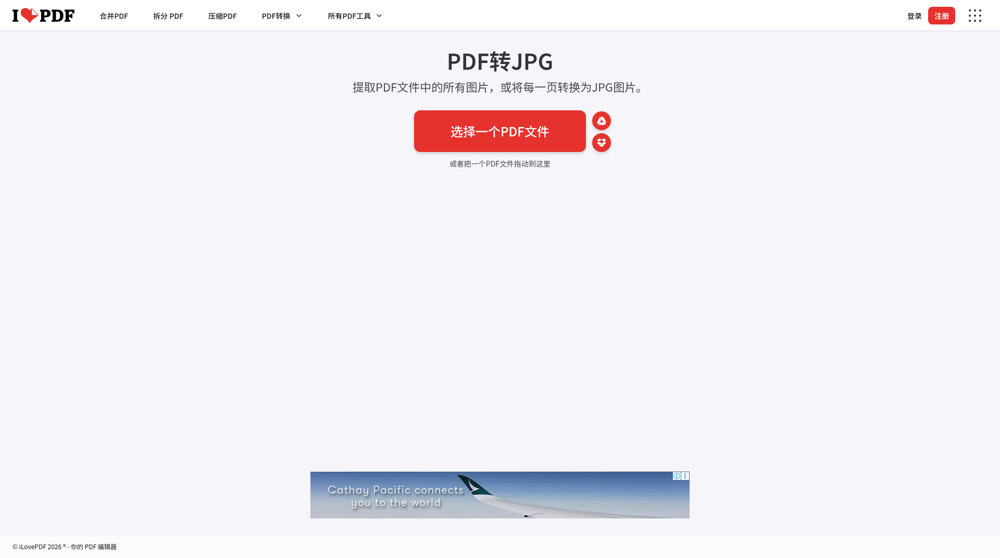
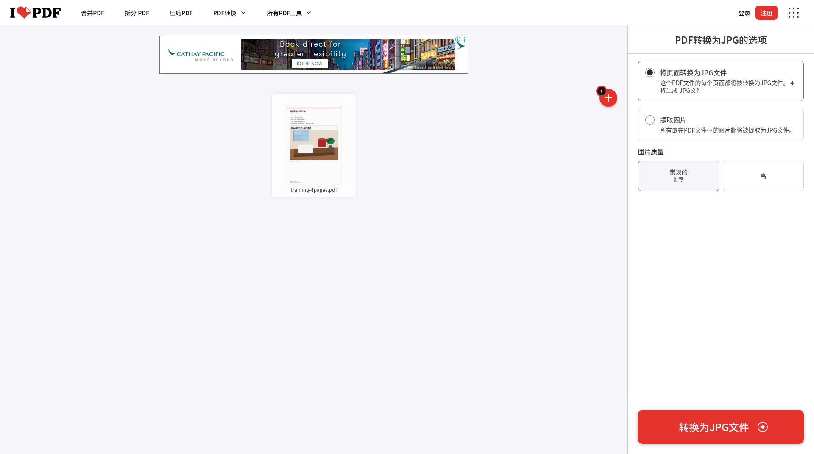
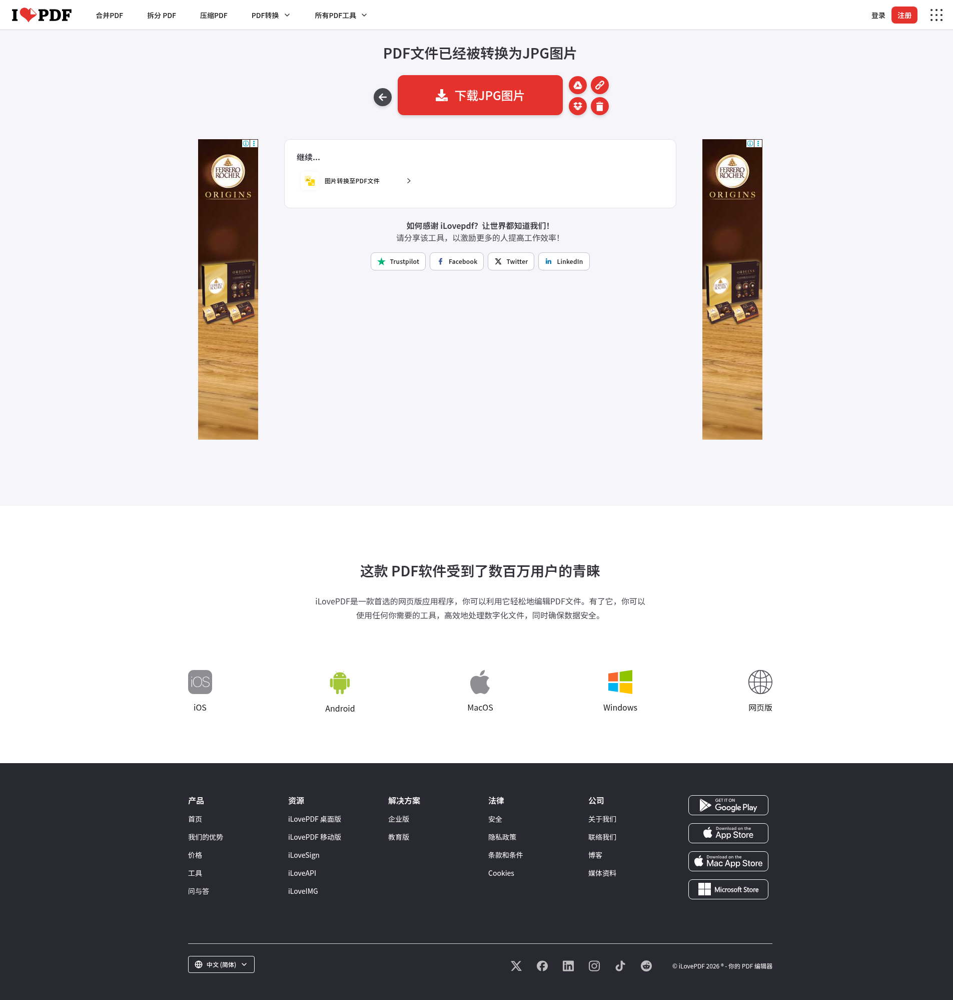
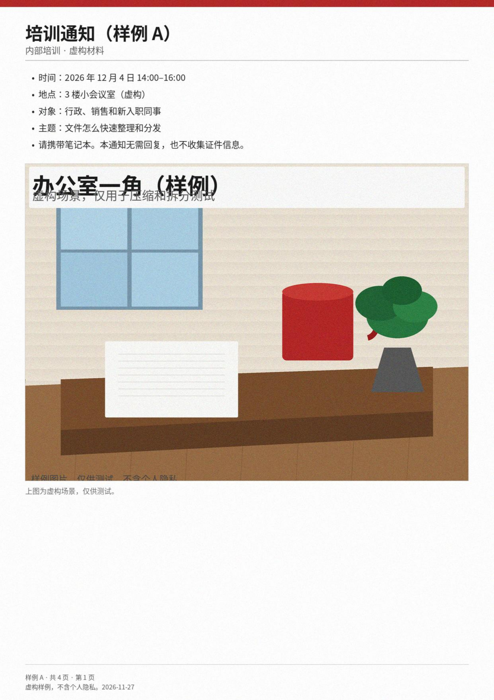
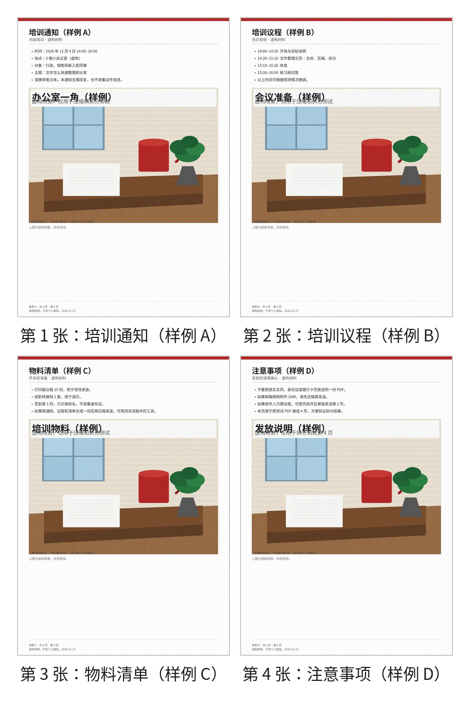

# PDF 转 JPG 免费在线：用 iLovePDF 把 PDF 页面导出成图片（实测）

要把 PDF 里的某一页或每一页存成图片，方便发聊天或插入文档，很多人会搜「PDF 转 JPG 免费」。这篇按本机实测，走通 iLovePDF 的在线转换：不用注册，不用付费，按页面默认选项就能把一份 4 页 PDF 的每一页导出成 JPG。4 张图都下到了，标题和正文仍然能读清。

这篇只写把 PDF 页面导出成 JPG，不是把图片合成 PDF，也不是把 PDF 转成 Word。

测试时间是 2026 年 11 月 28 日 09:28–09:30（曼谷时间）。样例是我们自己做的虚构 4 页培训材料 `training-4pages.pdf`，按文件字节数是 853,405 字节，不含真实通知、合同或个人隐私。

## 结论速查

1. 打开 [iLovePDF PDF 转 JPG](https://www.ilovepdf.com/zh-cn/pdf_to_jpg)。
2. 点「选择一个PDF文件」，上传要导出的 PDF。也可以把文件拖到页面上。
3. 右侧「PDF转换为JPG的选项」里，这次默认已选中「将页面转换为JPG文件」，并写着会生成 4 个 JPG 文件；图片质量默认是「常规的」（带「推荐」）。旁边还有「提取图片」和「高」，本机都没有改。
4. 点「转换为JPG文件」，等到出现「PDF文件已经被转换为JPG图片」后，再点「下载JPG图片」。这次进入结果页后，文件已经自动下载成一个 ZIP。

## 适合谁

- 要把 PDF 的页面存成图片，再发聊天或插入文档的人；
- 不想为此开会员、也不想先装软件的人。

文件会上传到对方的服务器。合同、证件、聊天记录或含身份证信息的 PDF，先想清楚要不要上传。敏感文件更适合在你自己的电脑里转换，这篇不展开离线方案。

## 用到的工具和费用

- 工具：[iLovePDF PDF 转 JPG](https://www.ilovepdf.com/zh-cn/pdf_to_jpg)
- 全程没有登录，没有付费。顶栏一直有「登录」和「注册」，但没有要求必须使用，也可以直接下载。
- 工具页、上传后的页面和结果页上有广告分区。结果页没有看到必须付费才能下载的提示。结果页的「继续...」里有「图片转换至PDF文件」入口，本机没有点。

同一类网页工具还有别的站点，这次 iLovePDF 已经走通，就没有再测其他网站。换工具时，请自己看清有没有登录或付费才能下载。

## 实际怎么操作

打开上面的地址后，页面标题是「PDF转JPG」，下面写着「提取PDF文件中的所有图片，或将每一页转换为JPG图片。」点「选择一个PDF文件」，选中要转换的 PDF。本机上传的就是上面那份 4 页虚构培训材料。

上传后，右侧栏标题是「PDF转换为JPG的选项」。默认已选中「将页面转换为JPG文件」，说明里写着这个 PDF 的每个页面都将被转换为 JPG 文件，并写明会生成 4 个 JPG 文件。下面还有「提取图片」，本机没有选。图片质量默认是「常规的」（带「推荐」），旁边有「高」，本机没有改。这次页面上没有看到 PNG 选项，也没有看到可以填写的分辨率数字。然后点「转换为JPG文件」。处理过程中，页面出现过「正在将PDF转换为JPG…...」。

完成后，结果页会显示「PDF文件已经被转换为JPG图片」。这次结果页上没有写出页数、文件大小或分辨率。页面上有「下载JPG图片」按钮；这次进入结果页后，一个 ZIP 已经自动出现在下载目录里。

## 实测结果

下载到的压缩包文件名是 `ilovepdf_pages-to-jpg.zip`，大小是 3,591,973 字节。解开后是 4 张 JPG，文件名按页码排列：

- `training-4pages_page-0001.jpg`，907,108 字节
- `training-4pages_page-0002.jpg`，898,722 字节
- `training-4pages_page-0003.jpg`，905,971 字节
- `training-4pages_page-0004.jpg`，912,169 字节

本机打开后，这 4 张都是 1240 × 1755 像素，文件信息里写着 150 dpi。页序和原 PDF 一致：第 1 张是「培训通知（样例 A）」，第 2 张是「培训议程（样例 B）」，第 3 张是「物料清单（样例 C）」，第 4 张是「注意事项（样例 D）」。标题、条目和页脚「样例 A · 共 4 页 · 第 1 页」等文字都还能读清。这份样例本身就是整页图，不是可选中复制的文字，所以这里核对的是导出来的画面。

这次打开的图片里，没有看到额外加上的水印文字，但不保证其他文件、其他时间也不会出现水印。这是按默认「常规的」质量得到的结果，只说明这次样例的标题和正文仍可读，不能写成「完全不失真」，也不能写成可以指定任意分辨率。本机没有改成「高」，换一份字更小、扫描更糊的 PDF，观感可能不一样。转换完成后，请自己打开图片，核对页数、顺序和文字。

## 使用时要注意

- 文件会上传到 iLovePDF 的服务器，不要上传含真实证件、合同、聊天记录或身份证信息的 PDF。
- 这次没有收费，页面上有广告。这是当天操作时的情况，以后如果改了规则，以当时页面为准。
- 多页 PDF 这次是打成一个 ZIP 再下载，里面按页码命名。解开后看一眼是不是 4 张、顺序对不对。
- 页面上还有「提取图片」，那是把嵌在 PDF 里的图单独拿出来，和「把每一页变成一张图」不是同一件事。本机没有测这个选项。
- 结果页的「继续...」会引导去做「图片转换至PDF文件」，那是相反操作，不要和这篇混在一起。

## 本机没有测的部分

- 没有测 PDF24 或其他 PDF 转 JPG 网站；
- 没有改图片质量，因此没有测「高」；
- 没有测「提取图片」；
- 页面上没有看到 PNG 选项，因此没有测导出为 PNG；
- 没有在 Windows 或手机浏览器里重复操作，按钮名称以你当天打开的页面为准；
- 没有测加密 PDF，也没有测特别大的文件。

如果你只想先拆出其中几页再导出，可以参考本站已经写过的 [PDF 拆分免费在线：用 PDF24 把一份文件按页拆开（实测）](https://www.mmfei.com/2026/11/pdf拆分免费在线pdf24/)。如果要把 PDF 转成可以编辑的 Word，可以参考 [PDF 转 Word 免费在线：用 iLovePDF 转成可编辑文档（实测）](https://www.mmfei.com/2026/11/pdf转word免费在线ilovepdf/)。不要把这篇里的页数或体积套到那两篇上。

