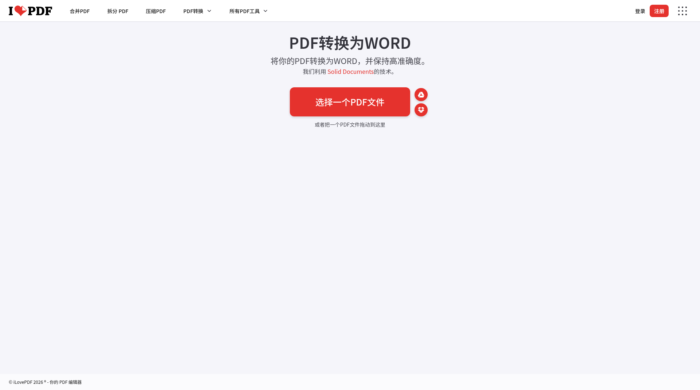
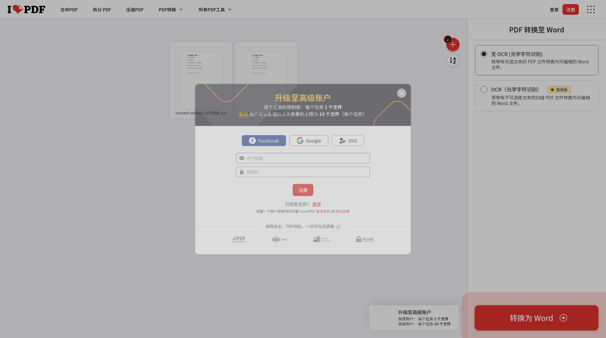
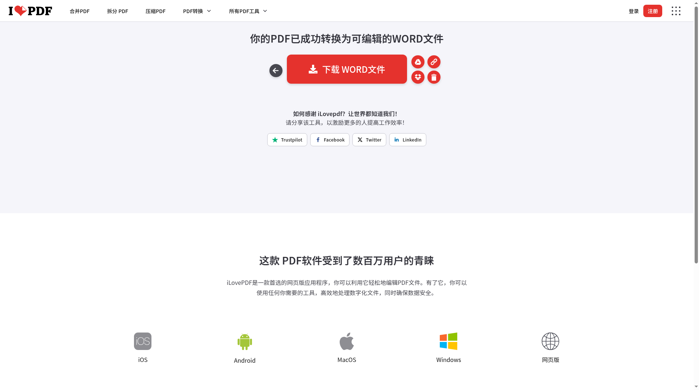
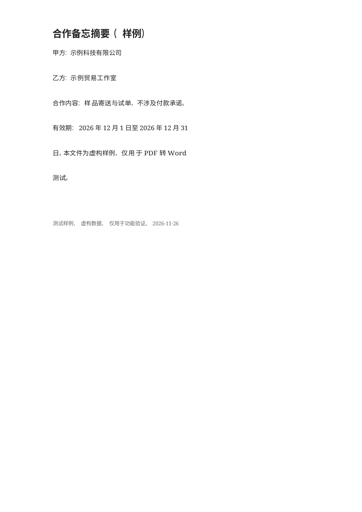

# PDF 转 Word 免费在线：用 iLovePDF 转成可编辑文档（实测）

只想改 PDF 里的几段字，却打不开可编辑的文档时，很多人会搜「pdf 转 word 免费网站」。这篇按本机 2026 年 11 月 26 日 09:53–09:54（曼谷时间）的实测，用 iLovePDF 网页版走通了免费、免登录的转换和下载，并把额度限制和版式问题写清楚。

测试用的是一份 1 页中文「合作备忘摘要」样例，内容是虚构的，不含真实公司资料。

## 结论速查

1. 打开 [iLovePDF 的 PDF 转 Word](https://www.ilovepdf.com/zh-cn/pdf_to_word)。
2. 一次只上传 1 个文件。免费账户的限制是每个任务 1 个文件。
3. OCR 选项标着「高级版」，免费转换时选「无 OCR」。
4. 点「转换为 Word」，完成后再点「下载 WORD文件」。
5. 打开后文字可以改，但个别换行和空格可能和原 PDF 不完全一致，重要文件请再核对。

## 适合谁

- 需要改 PDF 里的文字、表格或个别措辞，手头又没有可编辑原稿的人；
- 只想在网页里做完，不想先装软件的人。

扫描件、图片型 PDF 往往要靠 OCR。这次免费路径没有使用 OCR，扫描件能不能转好，本机没有测。

同样要注意：文件会上传到对方的服务器。不要上传含隐私的合同或证件。

## 用到的工具和费用

- 工具：[iLovePDF PDF 转 Word](https://www.ilovepdf.com/zh-cn/pdf_to_word)
- 免费可以转换带可选文本的 PDF。当天页面和弹窗里的原文是：免费账户每个任务 1 个文件，高级账户每个任务最多 10 个文件。
- OCR 选项标注「高级版」，本机没有选用。
- 页面写明，文件将于 2 小时后自动删除。
- 全程没有登录、没有付费，导出的 Word 里也没有水印。

这次第一候选已经走通，没有再测 PDF24 或其他网站。

## 实际怎么操作

打开页面，点「选择一个PDF文件」上传。如果误传了两份文件，页面会弹出「升级至高级账户」，并写「这个工具的限制是：每个任务 1 个文件」。这时不要急着开会员：关掉弹窗，把多余的文件点「删除此文件」，只留下 1 个，就可以继续。

确认只剩 1 个文件后，选「无 OCR (光学字符识别)」，再点「转换为 Word」。完成后页面显示「你的PDF已成功转换为可编辑的WORD文件」，点「下载 WORD文件」。

## 实测结果

本机下载的文件大小是 7698 字节，用 LibreOffice 可以正常打开。正文是可编辑的文字，不是把整页当成一张图，也没有水印。样例里的关键内容都在：合作备忘摘要、甲乙方名称、合作内容是样品寄送与试单、有效期为 2026 年 12 月 1 日至 31 日。

版式有轻微错乱，需要心里有数：

- 标题括号里多了空格，变成「（ 样例）」；
- 「有效期」那一行在「12 月 31」后面被断开，下一行从「日。」开始；
- 「测试。」被单独成了一段。

所以：能改字、内容还在，但不能假定排版会和原 PDF 完全一致。交正式文件前，请再检查一遍标题、日期和段落。

## 使用时要注意

- 免费额度是每个任务 1 个文件。多份文档请分多次转换，不要为了这个限制去开通会员，除非你自己决定付费。
- 文件会上传到 iLovePDF，并在页面所说的 2 小时后删除。不要上传敏感材料。
- 本机测的是本身就有文字的 1 页 PDF。扫描件、很复杂的表格或多栏排版，结果可能更差；这类情况本次没有测。
- 没有在 Microsoft Word 或 WPS 里打开核对，只在 LibreOffice 里确认文字可编辑。你用 Word 打开时，版式也可能再有差异。

