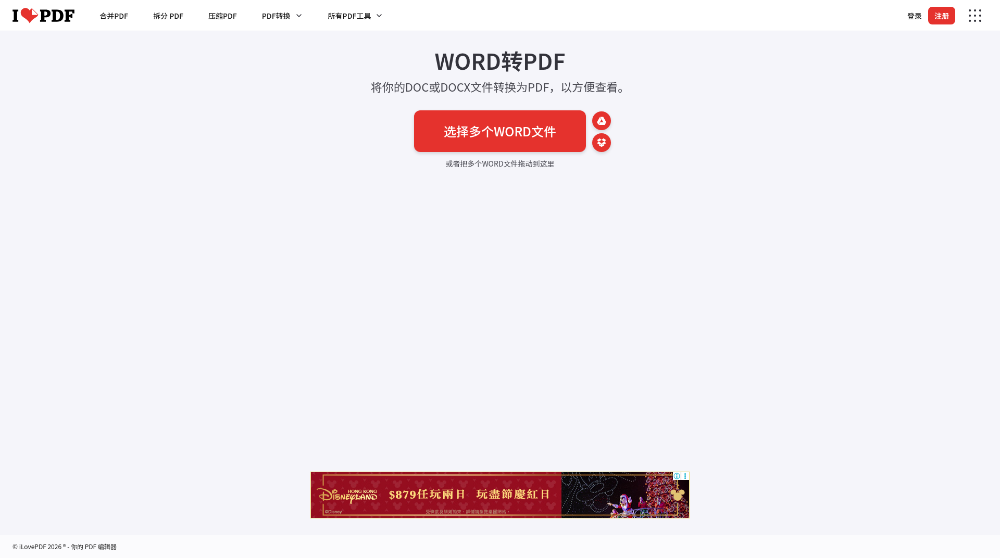
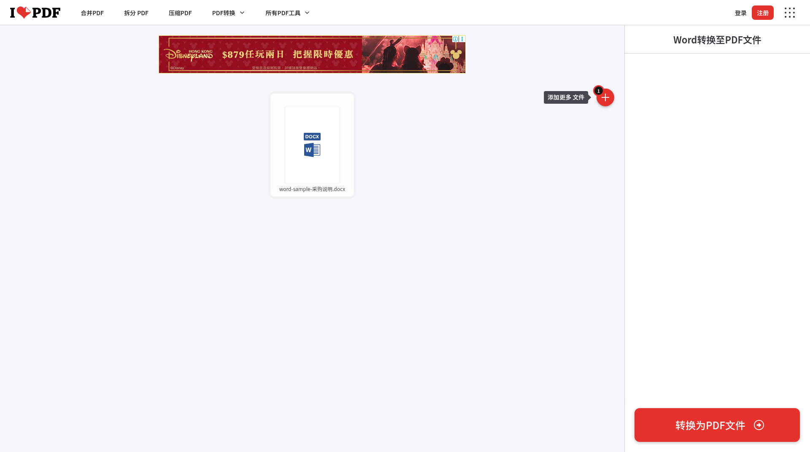
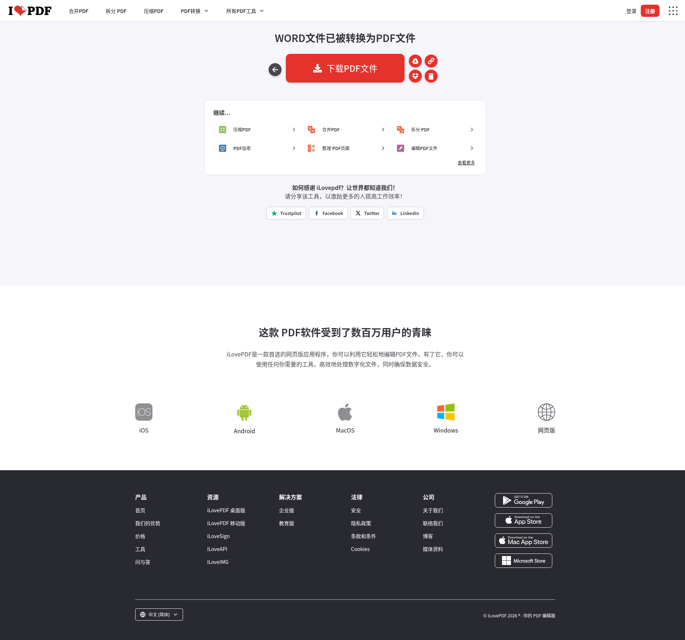
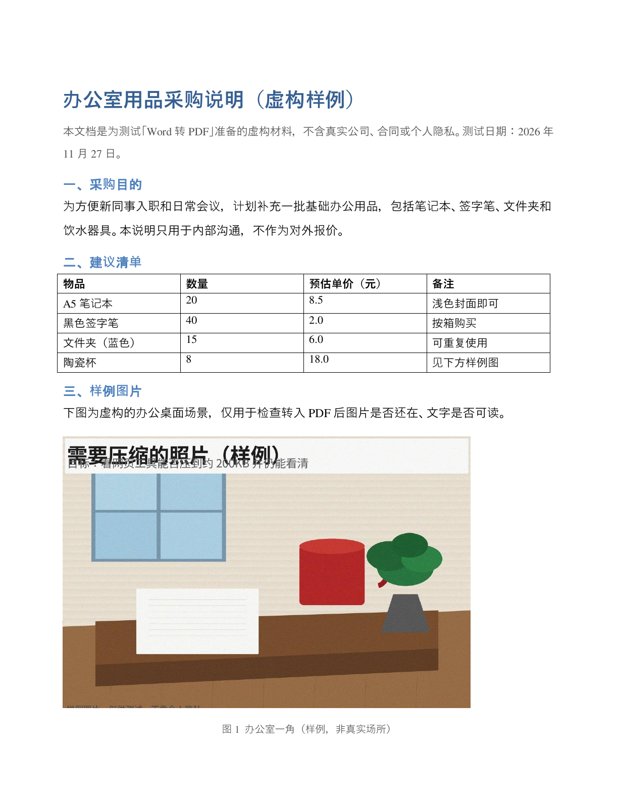

# Word 转 PDF 免费在线：用 iLovePDF 把文档转成可分发的 PDF（实测）

要把一份 Word 说明、清单或通知转成方便发给别人的 PDF，很多人会搜「Word 转 PDF 免费」。这篇按本机实测，走通 iLovePDF 的在线转换：不用注册，不用付费，按页面默认方式就能把一份虚构的采购说明转成 2 页 PDF，标题、表格和图片都还在。

测试时间是 2026 年 11 月 27 日 21:59–22:01（曼谷时间）。样例是我们自己做的虚构《办公室用品采购说明》，不含真实公司、合同或个人隐私。文中的单价只是测试用的数字，不能当作实际采购依据。

## 结论速查

1. 打开 [iLovePDF Word 转 PDF](https://www.ilovepdf.com/zh-cn/word_to_pdf)。
2. 点「选择多个WORD文件」，上传要转换的 Word 文档。也可以把文件拖到页面上。
3. 这次页面上没有出现可调选项，直接点「转换为PDF文件」。
4. 等到出现「WORD文件已被转换为PDF文件」后，点「下载PDF文件」。

## 适合谁

- 要把 Word 文档转成 PDF 再分发、存档或打印的人；
- 不想为此开会员、也不想先装软件的人。

文件会上传到对方的服务器。合同、报价单、证件或含身份证信息的文档，先想清楚要不要上传。敏感文件更适合在你自己的电脑里转换，这篇不展开离线方案。

## 用到的工具和费用

- 工具：[iLovePDF Word 转 PDF](https://www.ilovepdf.com/zh-cn/word_to_pdf)
- 全程没有登录，没有付费。顶栏一直有「登录」和「注册」，但没有要求必须使用，也可以直接下载。
- 工具页和上传后的页面上有广告分区。结果页没有看到必须付费才能下载的提示。

同一类网页工具还有别的站点，这次 iLovePDF 已经走通，就没有再测其他网站。换工具时，请自己看清有没有登录或付费才能下载。

## 实际怎么操作

打开上面的地址后，点「选择多个WORD文件」，选中要转换的文档。本机上传的是虚构采购说明 `word-sample-采购说明.docx`，按文件字节数是 169,955 字节。

右侧栏标题是「Word转换至PDF文件」，主按钮是「转换为PDF文件」。这次没有看到复选框、下拉菜单或其他转换档位，本机也没有改任何设置。然后点「转换为PDF文件」。

完成后，结果页会显示「WORD文件已被转换为PDF文件」。再点「下载PDF文件」，就可以保存到电脑。这次结果页上没有写出转换后的文件大小。

## 实测结果

本机下载到的文件名仍是原来的 `word-sample-采购说明.pdf`，大小是 779,626 字节，一共 2 页。打开后，第 1 页能看到标题「办公室用品采购说明（虚构样例）」，「二、建议清单」下的表格还在，四列分别是「物品」「数量」「预估单价（元）」「备注」，四行分别是 A5 笔记本、黑色签字笔、文件夹（蓝色）和陶瓷杯。「三、样例图片」下的图和说明「图 1 办公室一角（样例，非真实场所）」也还在。第 2 页是「四、注意事项」的三条说明，内容和原稿一致。两页里都没有发现额外水印。

这次样例比较简单，标题、表格和图片都还在，但不表示换一份排版更复杂的文档也会完全一样。转换完成后，请自己打开 PDF，核对标题、表格线、图片和页码。

## 使用时要注意

- 文件会上传到 iLovePDF 的服务器，不要上传含真实报价、合同、证件或身份证信息的文档。
- 这次没有收费，页面上有广告。这是当天操作时的情况，以后如果改了规则，以当时页面为准。
- 不同电脑上的 Word 字体和页边距可能本来就不一样，转成 PDF 是为了把版式固定下来。转换后仍要打开结果看一眼。
- 本机没有测试加密文档，也没有测试特别大的文件。如果某个文件转换失败，先确认它本身能不能打开、有没有密码。

## 本机没有测的部分

- 没有测 PDF24 或其他 Word 转 PDF 网站；
- 页面上没有可调选项，因此没有测其他转换档位；
- 没有在 Windows 或手机浏览器里重复操作，按钮名称以你当天打开的页面为准；
- 没有测 Word 或 WPS 自带的导出为 PDF。

如果你接下来要把转好的 PDF 压小再发送，可以参考本站已经写过的 [PDF 压缩免费在线：用 PDF24 把偏大的文件压小再发送（实测）](https://www.mmfei.com/2026/11/pdf压缩免费在线pdf24/)。

