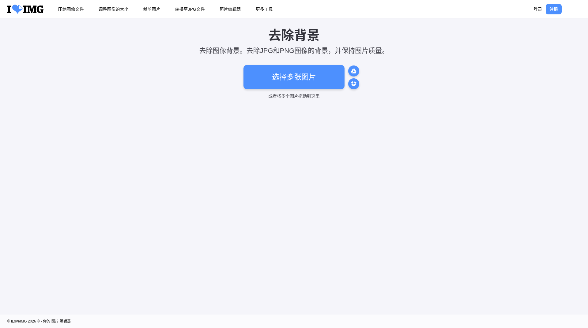
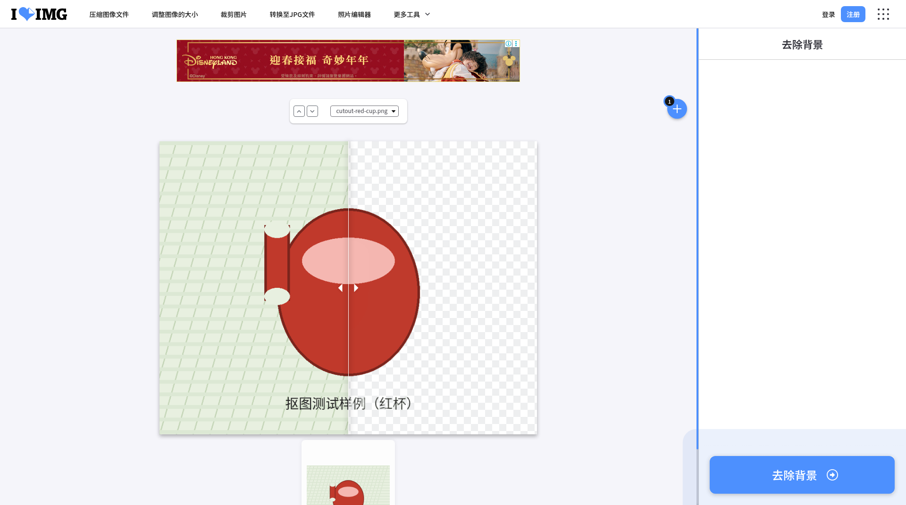
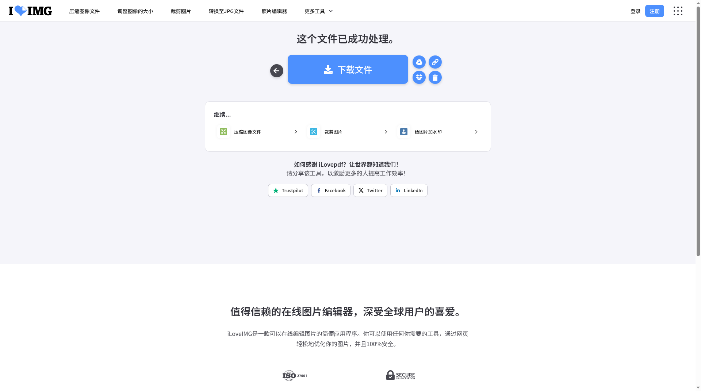
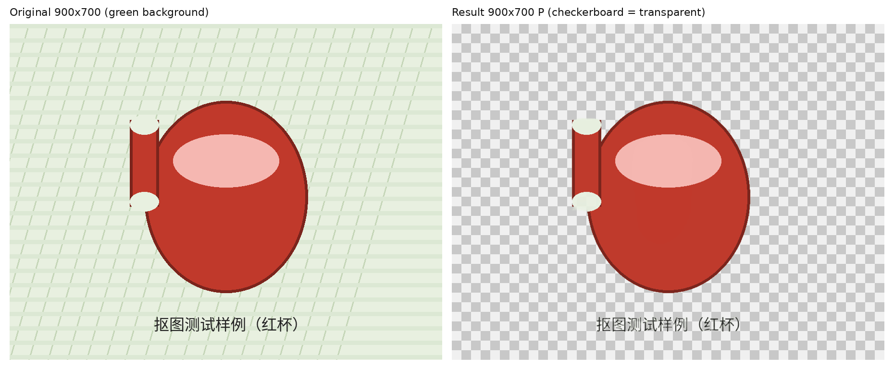

# 免登录在线抠图：用 iLoveIMG 把背景换成透明底（实测）

只想把一张图的背景去掉，换成透明底，又不想先注册或开会员。这篇按本机 2026 年 11 月 26 日 10:15–10:16（曼谷时间）的实测，用 iLoveIMG 网页版走通了免登录上传、去背景和下载。

测试用的是一张虚构的红杯样例，绿色网格背景，图上写着「抠图测试样例（红杯）」，不含人物肖像或其他隐私信息。

## 结论速查

1. 打开 [iLoveIMG 去除背景](https://www.iloveimg.com/zh-cn/remove-background)。
2. 点「选择多张图片」上传，预览里确认背景已经去掉后，再点「去除背景」。
3. 完成后页面显示「这个文件已成功处理。」，再点「下载文件」。
4. 这次下载的是带透明底的 PNG，没有水印，宽高仍是 900×700，和原图一样。
5. 图片会传到对方服务器，不要上传证件照或其他敏感照片。

## 适合谁

- 想给产品图、图标或简单实物图换成透明底的人；
- 只想在网页里做完，不想先装软件、也不想先注册的人。

人像样张、很碎的头发丝，或要把图里的文字一并去掉，这次没有测。

## 用到的工具和费用

- 工具：[iLoveIMG 去除背景](https://www.iloveimg.com/zh-cn/remove-background)
- 页头有「登录」「注册」，但这次没有登录，也能处理并下载。
- 这次没有出现付费或升级才能下载的提示，免费就取到了结果。
- 定价页对「基础版免费」写的是「有限制的文件处理」，高级账户则写「无限制的文件处理」。FAQ 里写：如果超出账户限制，系统会弹出信息阻止继续，而不是事后另收费。本次上传的原图是 19.21 KB、900×700，全程没有出现限制弹窗，具体额度以你打开当天的页面为准。

## 实际怎么操作

打开页面，点蓝色的「选择多张图片」，也可以把图片拖进去。上传后，预览里可以用中间的滑块左右对照：一边是原图，一边是已经去掉背景的效果。确认没问题后，点右侧的「去除背景」。

处理完成后，页面写着「这个文件已成功处理。」，再点「下载文件」。

## 实测结果

下载下来的是一张 900×700 的透明底 PNG，约 21 KB，没有看到水印或站点标志。绿色网格背景已经去掉，红杯、把手和高光都还在，杯子颜色和原图一致。图里的说明文字「抠图测试样例（红杯）」被当成前景留了下来，这是合理的，因为它本来就不是背景。杯沿有一些半透明的锯齿，属于去背景时常见的边缘处理，不像整张图的水印。

## 使用时要注意

- 文件会上传到第三方服务器，不要上传证件、人脸或其他敏感照片。
- 免费档对文件数量或尺寸可能有限制，以当天页面提示为准；这次这张小图没有撞到限制。
- 图里不想保留的文字或前景物体，网站不一定会自动去掉，下载后请再看一眼。
- 更复杂的人像、毛发边缘，这次没有测。

