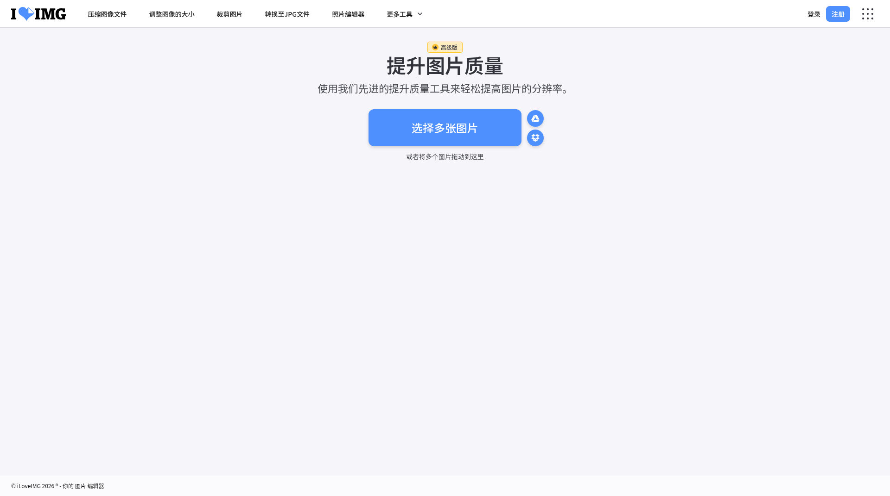
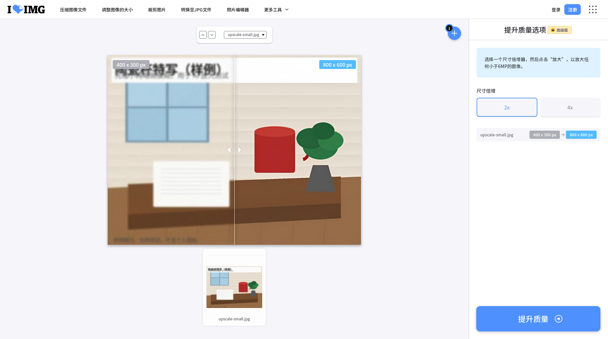
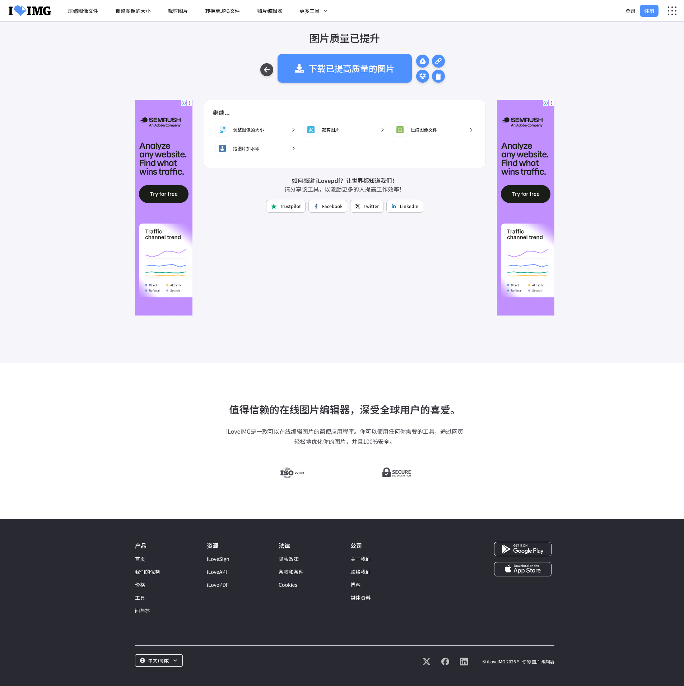
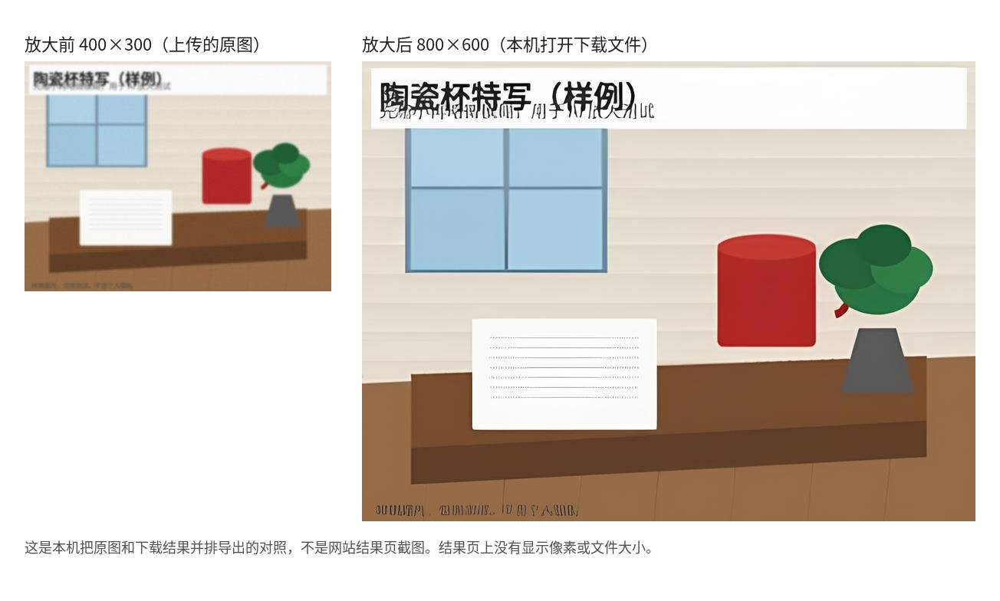

# 免费 AI 放大图片：用 iLoveIMG 把低分辨率照片按 2 倍放大（实测）

要把一张偏小或略模糊的照片放大后再用，很多人会搜「AI 放大图片免费」或「模糊图片变清晰」。这篇按本机实测，走通 iLoveIMG 的网页版提升图片质量：不用注册，不用付费，按页面预选的 2 倍，就能把一张 400×300 的样例放到 800×600。需要先说清楚：放大后的像素变大了，但原来已经比较糊的小字仍然读不清，不能当成「不失真」或一定能把模糊图片变清晰。

测试时间是 2026 年 11 月 27 日 22:07–22:15（曼谷时间）。样例是我们自己做的虚构「陶瓷杯特写」，不含个人隐私。

## 结论速查

1. 打开 [iLoveIMG 提升图片质量](https://www.iloveimg.com/zh-cn/upscale-image)。
2. 点「选择多张图片」，上传要放大的照片。也可以把图片拖到页面上。
3. 右侧「提升质量选项」里可以看到「尺寸倍增」，这次页面预选了 2x，旁边还有 4x。本机没有改这个选项。预览上会写明放大后的像素，这次是「400 x 300 px → 800 x 600 px」。然后点「提升质量」。
4. 等到出现「图片质量已提升」后，点「下载已提高质量的图片」。

## 适合谁

- 手里的照片或示意图偏小，想先放大再插入文档、网页或打印的人；
- 不想为此开会员、也不想先装软件的人。

照片会上传到对方的服务器。证件照、工作证件、聊天截图或含住址门牌的照片，先想清楚要不要上传。敏感照片更适合用只在你电脑里处理的工具，这篇不展开离线方案。

## 用到的工具和费用

- 工具：[iLoveIMG 提升图片质量](https://www.iloveimg.com/zh-cn/upscale-image)
- 全程没有登录，没有付费。顶栏一直有「登录」和「注册」，但没有要求必须使用，也可以直接下载。页面上能看到「高级版」标记，这次按预选的 2x 放大和下载时，没有出现必须付费才能继续的提示。本机没有点 4x，也不清楚 4x 会不会另有限制。
- 结果页两侧有广告。结果页的「继续...」列表里有「给图片加水印」，这是可选的下一步，本机没有点它；下载下来的文件里也没有看到额外水印。

同一类网页工具还有别的站点，这次 iLoveIMG 已经走通，就没有再测其他网站。换工具时，请自己看清有没有登录或付费才能下载。

## 实际怎么操作

打开上面的地址后，页面主标题是「提升图片质量」，下面写着「使用我们先进的提升质量工具来轻松提高图片的分辨率。」点「选择多张图片」，选中要放大的照片。本机上传的是虚构样例 `upscale-small.jpg`。按文件字节数是 10,748 字节，像素是 400×300。

右侧栏标题是「提升质量选项」，上面有「高级版」标记。说明写着：选择一个尺寸倍增器，然后点击“放大”，以放大任何小于6MP的图像。选项名是「尺寸倍增」，可见 2x 和 4x，其中 2x 已被预选。文件名下方以及左右预览上都写着「400 x 300 px → 800 x 600 px」。本机没有改倍数，然后点右下角的「提升质量」。说明里虽然写的是点击“放大”，这次实际看到并点击的按钮是「提升质量」。

完成后，结果页会显示「图片质量已提升」。再点「下载已提高质量的图片」，就可以保存到电脑。这次结果页上没有写出放大倍数、新的像素尺寸，也没有写出文件大小。结果页出现时，本机还自动下载了一份；再点按钮下到的是同一份文件。

## 实测结果

| 项目 | 大小 | 像素 |
| --- | --- | --- |
| 放大前 | 10,748 字节 | 400×300（上传后页面也写作 400 x 300 px） |
| 放大后 | 33,227 字节（结果页没有写出文件大小，这是下载后在本机查看的） | 800×600（点击「提升质量」前，页面已写作 800 x 600 px；下载文件也是这个尺寸） |

下载文件的默认名仍是原来的 `upscale-small.jpg`。打开后，标题「陶瓷杯特写（样例）」仍能看清，杯子、窗户和盆栽等色块也更大了。标题下方和画面底部原来就已经比较糊的小字，放大后仍然读不清，没有变成可以辨认的句子。图上没有发现额外水印。

## 不能当成不失真

不少人会搜「AI 如何放大图片不失真」或「模糊图片变清晰」。这次按页面预选的 2x，像素从 400×300 变成了 800×600，但原来糊掉的小字并没有被补成清楚可读的正文。

放大并不等于修复出原图里已经看不清的细节。不同照片的效果会差很多，尤其是人脸、文字或细线条。请先在电脑里打开下载结果，看清自己在意的那一块再使用。本机这次只用了预选的 2x，没有测 4x，也没有测其他网站。

## 使用时要注意

- 文件会上传到 iLoveIMG 的服务器，不要上传含证件、聊天记录、未公开文件或能认出住址的照片。
- 这次没有收费，页面上有广告，也有「高级版」标记。这是当天按 2x 操作时的情况，以后如果改了规则，以当时页面为准。
- 页面说明里写的是放大小于 6MP 的图像。本机这张样例远小于这个数字，没有测试更大的图片，也不验证这个上限。
- 本机没有测试特别大的文件，也没有测试一次上传很多张的情况。

## 本机没有测的部分

- 没有点 4x，因此没有 4 倍放大的结果，也不知道 4x 是否仍可免登录、免付费下载；
- 没有测其他在线放大网站；
- 没有在 Windows 或手机浏览器里重复操作，按钮名称以你当天打开的页面为准。

如果你接下来要把放大后的图片压小再上传，可以参考本站已经写过的 [在线压缩图片免费：用 iLoveIMG 把偏大的照片压小（实测）](https://www.mmfei.com/2026/11/在线压缩图片免费iloveimg/)。不要把这篇里的放大倍数套到压缩上。

