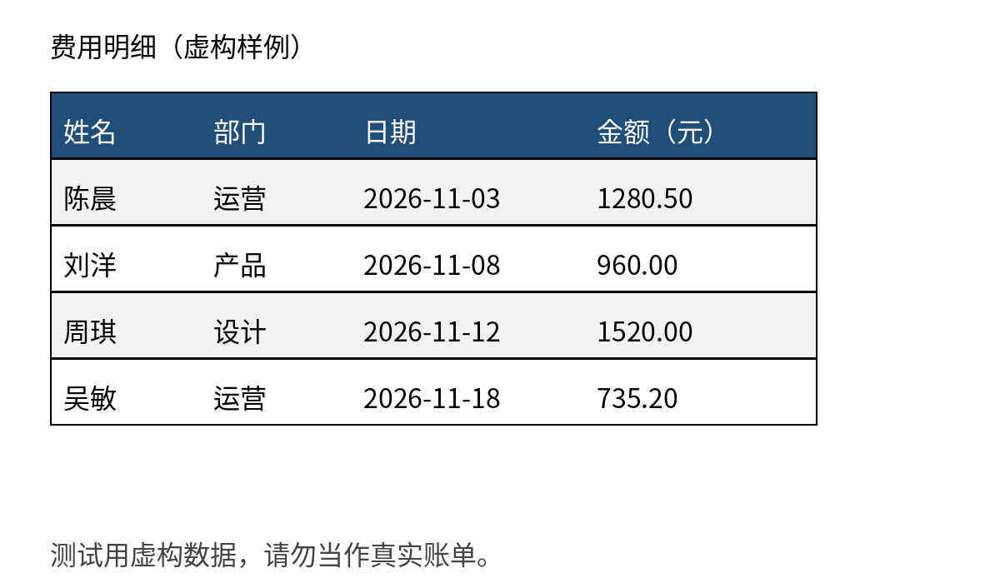
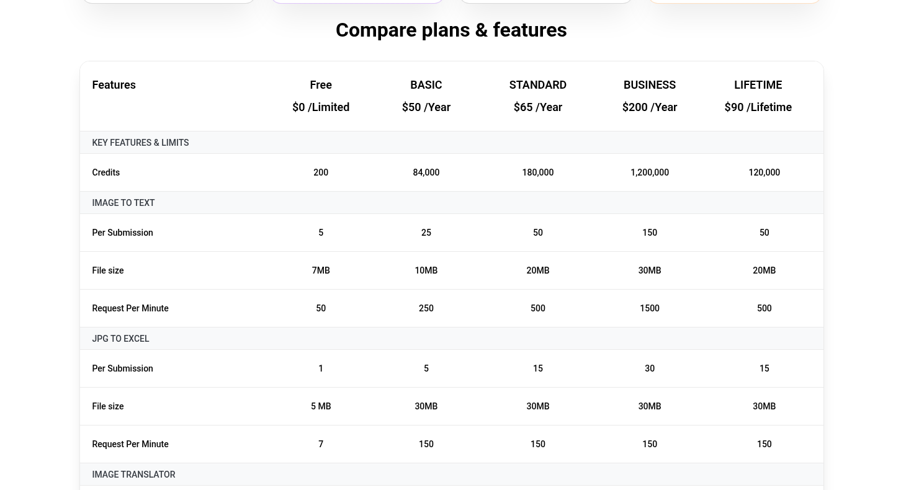
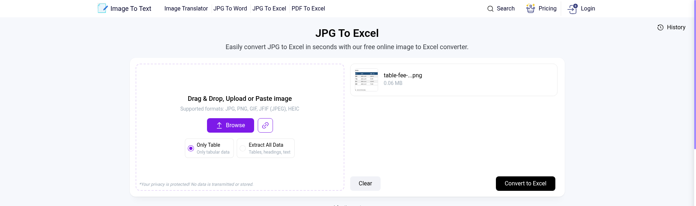
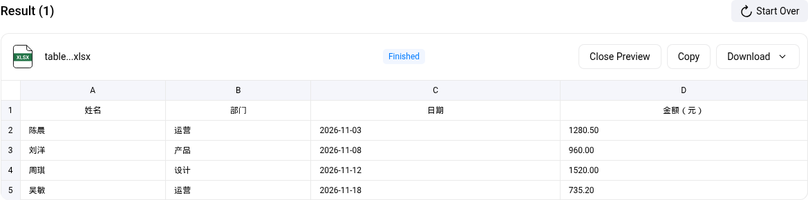
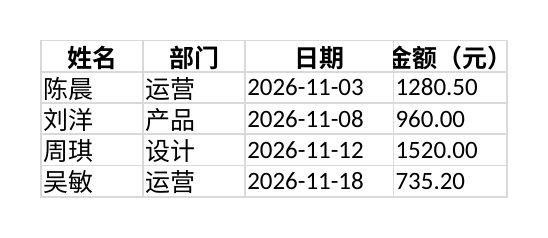

# 图片转 Excel 免费：用 ImageToText 把表格截图转成可编辑表格（实测）

手里只有一张表格截图，想把它变成能改的 Excel，又不想先装软件。这篇按本机 2026 年 11 月 26 日 10:26–10:33（曼谷时间）的实测，写出一条免登录、能下载可编辑 xlsx 的路径；定价页对比表和 FAQ 截图于同日 10:42–10:43 采集，并把免费额度和导出格式的边界写清楚。

测试用的是一份虚构的「费用明细」表格图，列是姓名、部门、日期、金额（元），四人分别是陈晨、刘洋、周琪、吴敏。图里没有真实账单或个人隐私。

## 结论速查

1. 常见的 [iLovePDF](https://www.ilovepdf.com/zh-cn) 和 [PDF24](https://tools.pdf24.org/zh/all-tools) 当天都没有「图片转 Excel」工具。
2. 可以走通、并且能得到可用表格的路径是 [ImageToText.info 的 JPG To Excel](https://www.imagetotext.info/jpg-to-excel)：上传图片，选项保持「Only Table」，再点 Convert to Excel，完成后点 Download，选择 .xlsx (Excel)。
3. 这次没有登录，也能下载 xlsx。打开后已分成「姓名 / 部门 / 日期 / 金额（元）」四列，四人姓名「陈晨、刘洋、周琪、吴敏」都在可编辑单元格里，部门和金额、日期也能对上。工作表没有保护，也没有把原图嵌进去冒充表格。
4. 定价页对比表写明：免费档有 200 credits；JPG To Excel 免费档每次提交 1 张、文件不超过 5 MB；Credits Overview 写 Only Table 每次 20 credits。FAQ 另写访客每天 30 次转换、注册用户每天 50 次，和 200 credits 不是同一套表述。本次没有登录，按 FAQ 属于访客。页面有 Login 和升级入口，但下载不是必经步骤。图片会传到对方服务器，不要上传含隐私的表格。

## 适合谁

- 手头只有表格截图或扫描图，想得到一份能打开、能改格子的 Excel 的人；
- 只想在网页里做完，不想先装软件的人。

这次测的是一张字迹清楚、四列对齐的中文表格截图。手写、拍照倾斜、更复杂的多列表，以及 WPS、Excel 自带的「图片中的数据」，这次没有测。

## 用到的工具和费用

- 工具：[ImageToText.info JPG To Excel](https://www.imagetotext.info/jpg-to-excel)
- 页头有 Login、Pricing，也有 Upgrade to Pro，但这次没有登录、没有付费，就能上传、转换并下载。
- 打开 [定价页](https://www.imagetotext.info/premium) 时，本次截到的是 Yearly 视图下的「Compare plans & features」对比表。免费档一列写的是 Free，$0 / Limited，Credits 为 200。同一张表的 JPG TO EXCEL 分组里，免费档是每次提交 1 张、文件不超过 5 MB、每分钟最多 7 次请求。不要和上面 IMAGE TO TEXT 那几行（免费档每次 5 张、7MB）搞混。

- 同一页的 Credits Overview 写明：JPG TO EXCEL 的 Only Table 为 20 Credits / Image。本次用的就是 Only Table，只转换了 1 张图。

- 同一页 FAQ「Is there a Free Trial Version?」还写：注册用户每天 50 次转换，访客（guest users）每天 30 次转换。这和对比表里的 200 credits 不是同一套表述。本次没有登录，按 FAQ 属于访客，对应每天 30 次；具体以当天页面为准。

- 过程中页面下方会出现广告，关掉或不点即可，不必登录或付费。

## 实际怎么操作

打开 [JPG To Excel](https://www.imagetotext.info/jpg-to-excel)，点 Browse 上传表格图。选项保持默认的「Only Table」（只提取表格数据），再点 Convert to Excel。

这次上传的是同一张测试图的英文文件名副本 `table-fee-list.png`，和中文文件名的「费用明细」图内容完全一致。

转换完成后，页面会出现 Result，预览里就能看到分好的列。点 Download，再选 .xlsx (Excel) 保存。也可以选 .csv (CSV)，这次主路径下载的是 xlsx。

## 实测结果

下载下来的文件大小约 18 KB。用表格软件打开后，工作表没有设保护，也没有水印，更没有把原图嵌在表里。可编辑单元格是这样的：

- 表头是「姓名、部门、日期、金额（元）」四列。
- 四行数据分别是：陈晨 / 运营 / 2026-11-03 / 1280.50；刘洋 / 产品 / 2026-11-08 / 960.00；周琪 / 设计 / 2026-11-12 / 1520.00；吴敏 / 运营 / 2026-11-18 / 735.20。第三人是「周琪」，不是其他近音字。
- 姓名、部门、日期、金额都在对应的格子里，可以对着原图逐格核对。

需要留意的边界是：这次导出的日期和金额都是文本，不是数字或日期格式。能改、能复制，但如果要在表格里求和或筛选日期，需要自己再转成数字或日期。

## 使用时要注意

- 文件会上传到第三方服务器，不要上传工资表、账单原件或其他敏感材料。
- 免费档同时有对比表里的 credits、每次张数和大小，以及 FAQ 里的每日转换次数，两套表述不一样，都以当天定价页为准。本次未登录，完成了 1 张图的转换和下载。
- 页面上的升级、广告不是下载的必经步骤，不点即可。
- 本机测的是一张字迹清楚的中文表格截图。手写、拍照倾斜、更复杂的多列表，结果未必一样。
- 没有在 Microsoft Excel 或 WPS 里打开核对，只在 LibreOffice 里确认单元格可编辑。你用 Excel 打开时，显示可能略有差异。

