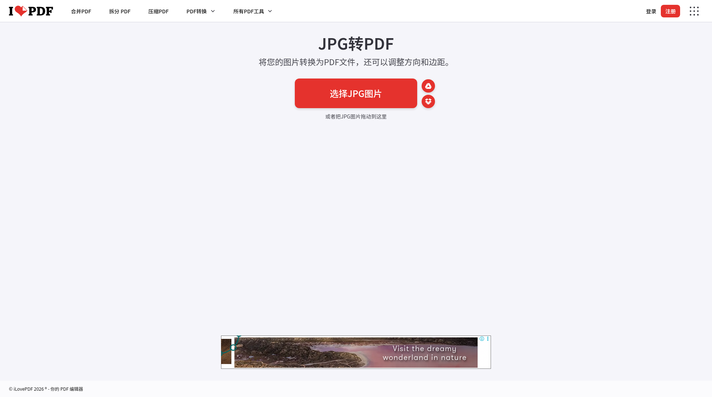
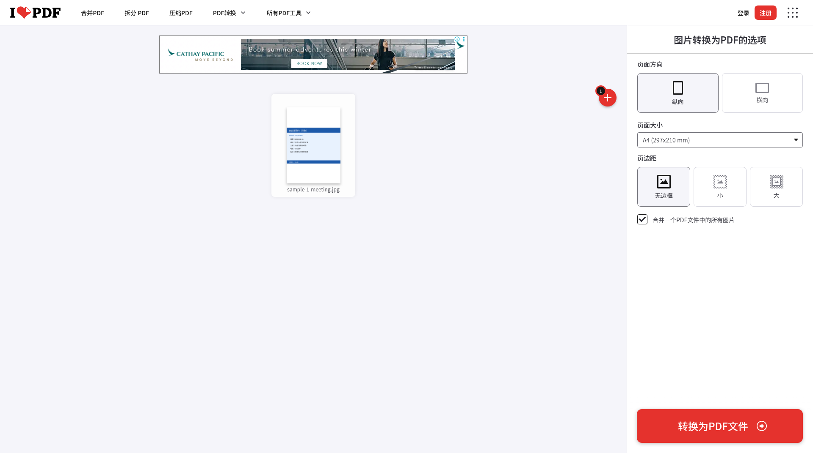
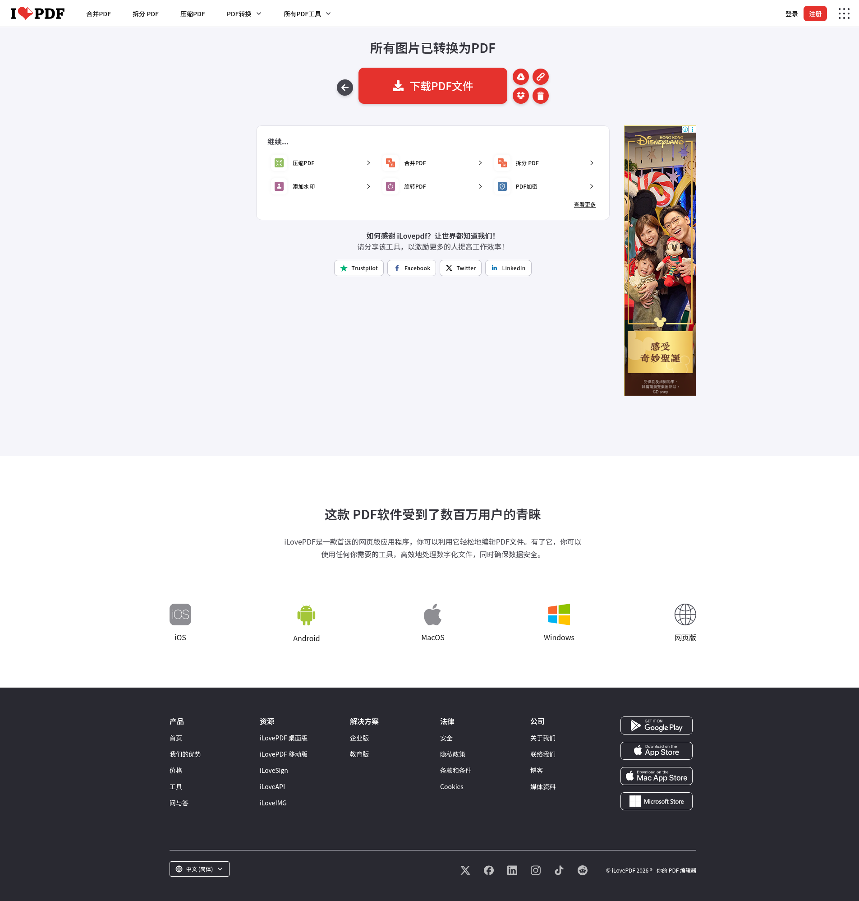
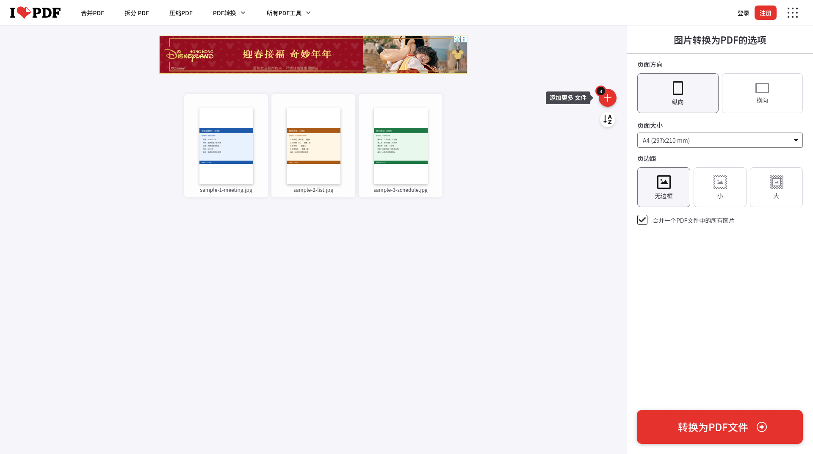
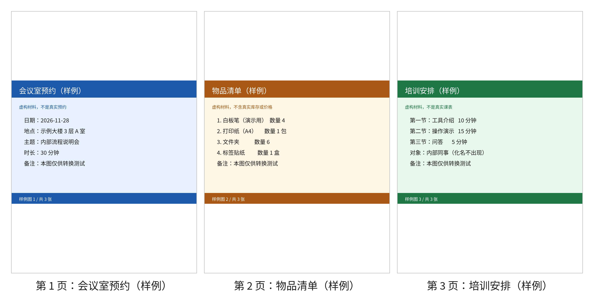

# 图片转 PDF 免费在线：用 iLovePDF 把照片合成一份 PDF（实测）

要把一张照片、截图，或好几张图合成一份方便发送、存档的 PDF，很多人会搜「图片转 PDF 免费」。这篇按本机实测，走通 iLovePDF 的在线转换：不用注册，不用付费，按页面默认选项就能把图片转成 PDF。单张样例得到 1 页；3 张按上传顺序合成后是 3 页，页上的文字仍然能读清。

这篇只写把图片转成 PDF，不是把 Word 转成 PDF，也不是压缩图片或压缩 PDF。

测试时间是 2026 年 11 月 28 日 09:19–09:22（曼谷时间）。样例是我们自己做的 3 张虚构办公材料图，分别写着「会议室预约（样例）」「物品清单（样例）」「培训安排（样例）」，不含真实预约、库存、课表或个人隐私。

## 结论速查

1. 打开 [iLovePDF JPG 转 PDF](https://www.ilovepdf.com/zh-cn/jpg_to_pdf)。
2. 点「选择JPG图片」，上传一张图，或按你要的页序连续选多张。也可以把图片拖到页面上。
3. 右侧「图片转换为PDF的选项」里，这次默认是页面方向「纵向」、页面大小「A4 (297x210 mm)」、页边距「无边框」，并且已勾选「合并一个PDF文件中的所有图片」。本机没有改这些选项。
4. 点「转换为PDF文件」，等到出现「所有图片已转换为PDF」后，再点「下载PDF文件」。

## 适合谁

- 要把一张或多张照片、截图合成一份 PDF，再发送、存档或打印的人；
- 不想为此开会员、也不想先装软件的人。

文件会上传到对方的服务器。证件、合同、聊天记录或含身份证信息的截图，先想清楚要不要上传。敏感文件更适合在你自己的电脑里转换，这篇不展开离线方案。

## 用到的工具和费用

- 工具：[iLovePDF JPG 转 PDF](https://www.ilovepdf.com/zh-cn/jpg_to_pdf)
- 全程没有登录，没有付费。顶栏一直有「登录」和「注册」，但没有要求必须使用，也可以直接下载。
- 工具页、上传后的页面和结果页上有广告分区。结果页没有看到必须付费才能下载的提示。结果页上的「继续...」里有「添加水印」等其他工具入口，本机没有点。

同一类网页工具还有别的站点，这次 iLovePDF 已经走通，就没有再测其他网站。换工具时，请自己看清有没有登录或付费才能下载。

## 实际怎么操作

打开上面的地址后，页面标题是「JPG转PDF」，下面写着「将您的图片转换为PDF文件，还可以调整方向和边距。」点「选择JPG图片」，选中要转换的图片。

本机先测了单张：上传的是 `sample-1-meeting.jpg`，按文件字节数是 68,762 字节。上传后，右侧栏标题是「图片转换为PDF的选项」，主按钮是「转换为PDF文件」。本机没有改任何选项，然后点「转换为PDF文件」。处理过程中，页面出现过「正在将图片转换为PDF…」。

完成后，结果页会显示「所有图片已转换为PDF」。这次结果页上没有写出页数，也没有写出转换后的文件大小。再点「下载PDF文件」，就可以保存到电脑。单张这次在转换完成后，文件已经出现在下载目录里。

接着再测多张合成。本机重新打开同一个地址，按 1、2、3 的顺序上传了 3 张图：`sample-1-meeting.jpg`（68,762 字节）、`sample-2-list.jpg`（71,021 字节）、`sample-3-schedule.jpg`（68,673 字节）。页面上从左到右就是这个顺序，计数是 3。右侧选项仍是默认的「纵向」、「A4 (297x210 mm)」、「无边框」，并且「合并一个PDF文件中的所有图片」默认已经勾选，所以本机没有再改。然后同样点「转换为PDF文件」，等到结果页后再点「下载PDF文件」。

## 实测结果

单张下载到的文件名是 `sample-1-meeting.pdf`，大小是 31,910 字节，一共 1 页。多张合成后，程序给出的文件名仍是 `sample-1-meeting.pdf`（沿用第一张图的名字），大小是 97,614 字节，一共 3 页。两份都是纵向 A4（本机测到页面是 595 × 842 点）。

打开合成后的 PDF，页序和上传顺序一致：第 1 页是「会议室预约（样例）」，第 2 页是「物品清单（样例）」，第 3 页是「培训安排（样例）」。三页上的标题、正文和脚注「样例图 1 / 共 3 张」等文字都还能读清。单张结果和合成文件的第 1 页画面相同。

这 3 张样例都是 1200 × 800 的横向图。在默认的纵向 A4、「无边框」下面，图片被放到页面中间，上下各留出一块空白。这是这次默认选项下的版式，不是把画面裁掉了。本机没有改成「横向」，也没有改成「匹配（页面尺寸与图片尺寸一样大）」，所以不能写成换一个选项就一定没有空白。

单张原图是 68,762 字节，转成 PDF 后是 31,910 字节，体积和原图不一样。这只是这次样例的结果，不能当成压缩工具，也不表示换一张更大或更小的照片会得到同样的比例。这次打开的页面里，没有看到额外加上的水印文字，但不保证其他文件、其他时间也不会出现水印。转换完成后，请自己打开 PDF，核对页数、顺序和画面。

## 使用时要注意

- 文件会上传到 iLovePDF 的服务器，不要上传含真实证件、合同、聊天记录或身份证信息的图片。
- 这次没有收费，页面上有广告。这是当天操作时的情况，以后如果改了规则，以当时页面为准。
- 多张图时，页序按你上传的顺序走。上传前先排好，转换后打开看一眼。
- 横向照片放到纵向 A4 上，上下可能会留白。如果要改方向或页面大小，以你当天打开的选项为准；那些档位本机没有测。
- 合成后的下载文件名可能仍沿用第一张图的名字，注意不要和单张结果混在一起。

## 本机没有测的部分

- 没有测 PDF24 或其他图片转 PDF 网站；
- 没有改页面方向、页面大小或页边距，因此没有测「横向」、按图片尺寸匹配，也没有测「小」「大」边距；
- 没有取消勾选「合并一个PDF文件中的所有图片」，因此没有测「每张图各下一份 PDF」；
- 没有测 PNG、WEBP 等其他格式，这次上传的是 JPG；
- 没有在 Windows 或手机浏览器里重复操作，按钮名称以你当天打开的页面为准；
- 没有测本机「打印为 PDF」。

如果你手上是 Word 文档而不是图片，可以参考本站已经写过的 [Word 转 PDF 免费在线：用 iLovePDF 把文档转成可分发的 PDF（实测）](https://www.mmfei.com/2026/11/word转pdf免费在线ilovepdf/)。如果转好的 PDF 偏大、想先压小再发送，可以参考 [PDF 压缩免费在线：用 PDF24 把偏大的文件压小再发送（实测）](https://www.mmfei.com/2026/11/pdf压缩免费在线pdf24/)。不要把这篇里的页数或体积套到那两篇上。

