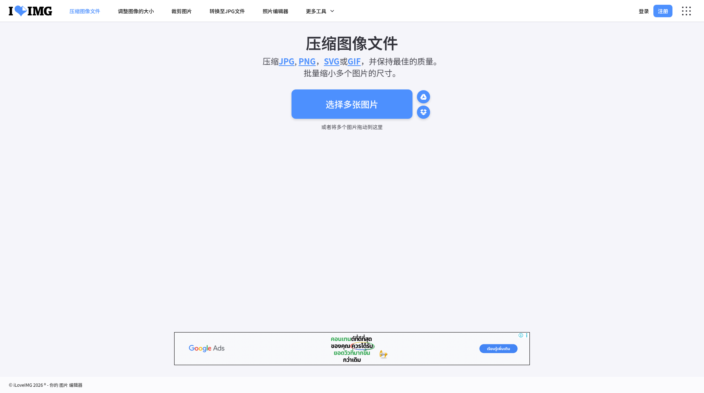
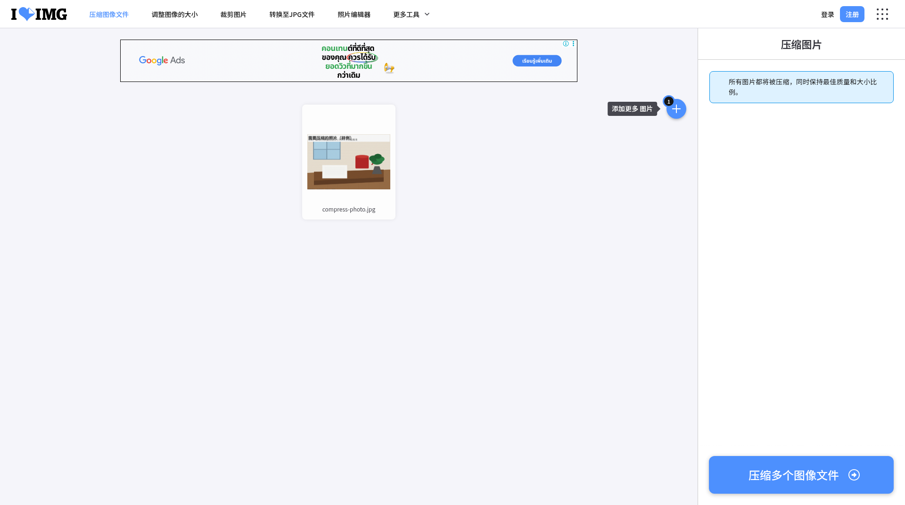
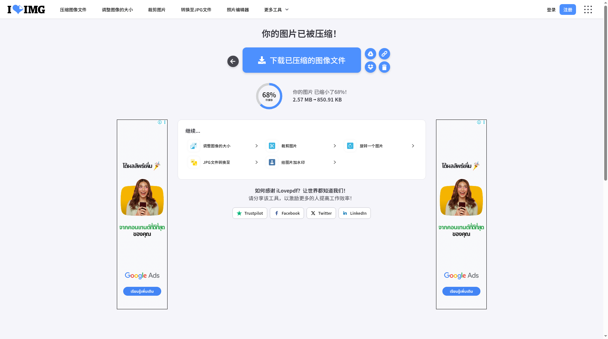
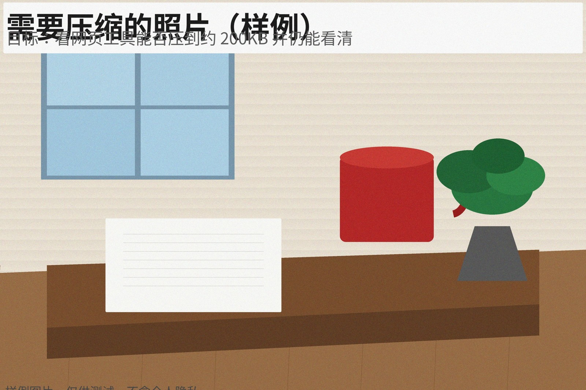

# 在线压缩图片免费：用 iLoveIMG 把偏大的照片压小（实测）

要把一张偏大的照片发到邮箱、上传到表格或当作头像，最常见的拦路虎就是体积上限，很多人会搜「图片压缩到 200KB 以内」。这篇按本机实测，走通 iLoveIMG 的在线压缩：不用注册，不用付费，按页面默认方式就能把一张 2.57MB 的照片压到 850.91KB。需要先说清楚：这次没有压到 200KB，默认压缩并不保证能压到某个固定大小。

测试时间是 2026 年 11 月 27 日 21:55:06–21:55:51（曼谷时间）。样例是我们自己做的虚构办公场景照片，不含个人隐私。

## 结论速查

1. 打开 [iLoveIMG 压缩图像](https://www.iloveimg.com/zh-cn/compress-image)。
2. 点「选择多张图片」，上传要压缩的照片。也可以把图片拖到页面上。
3. 右侧会看到说明「所有图片都将被压缩，同时保持最佳质量和大小比例。」这次页面上没有出现可调的压缩档位，直接点「压缩多个图像文件」。
4. 等到出现「你的图片已被压缩！」以及缩小比例后，点「下载已压缩的图像文件」。

## 适合谁

- 要把偏大的照片或截图压小，再上传、发送或当作头像的人；
- 不想为此开会员、也不想先装软件的人。

照片会上传到对方的服务器。证件照、工作证件、聊天截图或含住址门牌的照片，先想清楚要不要上传。敏感照片更适合用只在你电脑里处理的工具，这篇不展开离线方案。

## 用到的工具和费用

- 工具：[iLoveIMG 压缩图像](https://www.iloveimg.com/zh-cn/compress-image)
- 全程没有登录，没有付费。顶栏一直有「登录」和「注册」，但没有要求必须使用，也可以直接下载。
- 页面上有广告分区。结果页的「继续...」列表里有「给图片加水印」，这是可选的下一步，本机没有点它；下载下来的文件里也没有看到额外水印。

同一类网页工具还有别的站点，这次 iLoveIMG 已经走通，就没有再测其他网站。换工具时，请自己看清有没有登录或付费才能下载。

## 实际怎么操作

打开上面的地址后，点「选择多张图片」，选中要压缩的照片。本机上传的是虚构办公场景照片 `compress-photo.jpg`。按文件字节数是 2,696,959 字节，像素是 3200×2133。

右侧栏标题是「压缩图片」，并写着「所有图片都将被压缩，同时保持最佳质量和大小比例。」这次没有看到质量滑块或「压到指定大小」的选项，本机也没有改任何设置。然后点「压缩多个图像文件」。

完成后，结果页会显示「你的图片已被压缩！」，圆圈里是「68%」和「已保存」，旁边写着「你的图片 已缩小了68%！」以及「2.57 MB → 850.91 KB」。再点「下载已压缩的图像文件」，就可以保存到电脑。

## 实测结果

| 项目 | 大小 | 像素 |
| --- | --- | --- |
| 压缩前 | 2,696,959 字节（结果页写作 2.57 MB） | 3200×2133 |
| 压缩后 | 871,335 字节（结果页写作 850.91 KB） | 3200×2133 |

体积按结果页显示缩小了 68%。下载文件的默认名仍是原来的 `compress-photo.jpg`。压缩后的像素尺寸没有变，图上的样例标题「需要压缩的照片（样例）」和说明文字仍能看清，没有发现额外水印。

## 这次没有压到 200KB

样例图上写着测试目标「看网页工具能否压到约 200KB 并仍能看清」，但按页面默认方式，结果是 850.91KB，没有到 200KB。

不同照片的压缩幅度会差很多。如果页面上没有「指定目标大小」的选项，就不要假定默认压缩一定能压进 200KB、500KB 或某个邮箱上限。先看结果页上的新体积；如果还是太大，再考虑先缩小尺寸，或换一个能指定目标大小的工具，并自己打开结果看清画面。本机这次只用了页面默认方式，没有再测其他网站。

## 使用时要注意

- 文件会上传到 iLoveIMG 的服务器，不要上传含证件、聊天记录、未公开文件或能认出住址的照片。
- 这次没有收费，页面上有广告。这是当天操作时的情况，以后如果改了规则，以当时页面为准。
- 压缩会降低画质。这次像素尺寸没变，文字仍能看清，但不表示换一张细节很多的照片也会一样清楚。请先打开结果再发送。
- 本机没有测试特别大的文件，也没有测试一次上传很多张的情况。

## 本机没有测的部分

- 没有测 TinyPNG、Squoosh 或其他压缩网站；
- 页面上没有可调档位，因此没有测「压到指定大小」；
- 没有在 Windows 或手机浏览器里重复操作，按钮名称以你当天打开的页面为准。

如果你接下来要把 Word 文档转成便于分发的 PDF，或把一张偏小的图片放大后再使用，请等本站对应的实测文章上线后再看，不要把这篇里的压缩比例套到那些操作上。

