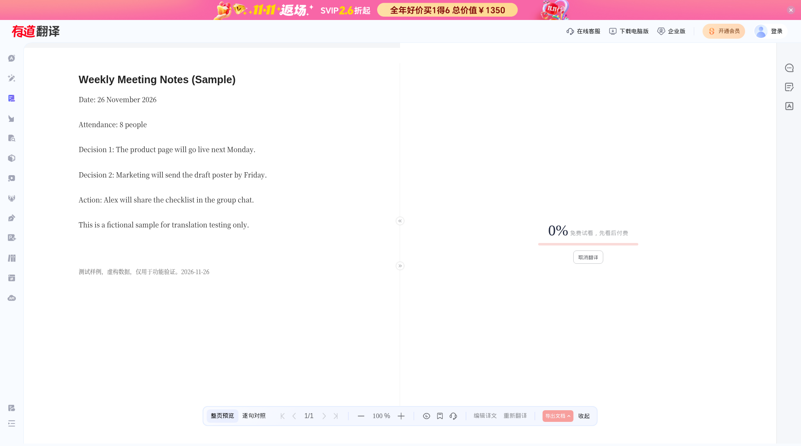
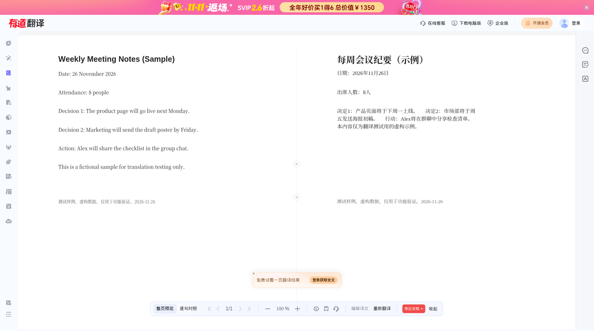
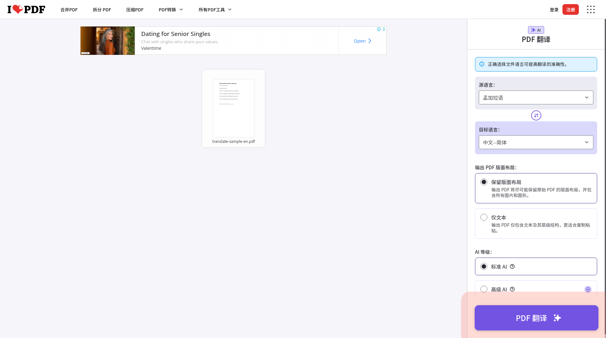
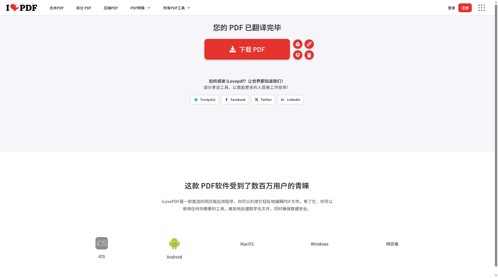
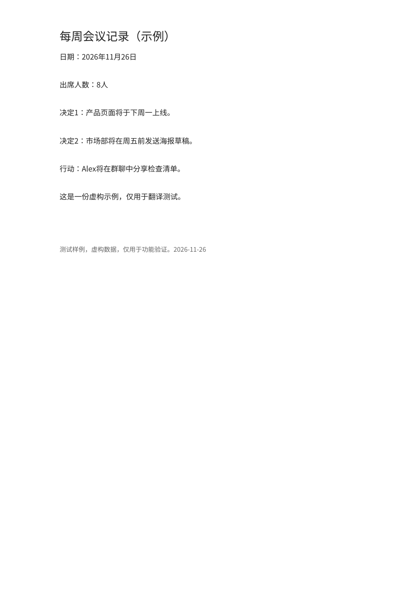

# 在线翻译 PDF：免登录把英文文档译成中文（实测）

拿到一份英文 PDF，只想在网页里译成中文并下载下来，不必先装软件。网上常提到百度翻译、有道翻译和谷歌翻译。这篇按本机 2026 年 11 月 26 日 09:45–09:52（曼谷时间）的实测，把能走通、和走不通的路径都写清楚。

测试用的是一份 1 页英文会议纪要样例，内容是虚构的，不含个人隐私。

## 结论速查

1. 国内常去的百度翻译、有道翻译，这次都没能在不登录的情况下下载完整译文。
2. 可以走通的路径是 [iLovePDF 翻译 PDF](https://www.ilovepdf.com/zh-cn/translate-pdf)：上传文件，目标语言选「中文--简体」，模型选「标准 AI」，再点「PDF 翻译」并下载。
3. 任何在线翻译都会把文件传到对方服务器，不要上传含隐私的 PDF。

## 先说国内常用网站的情况

### 百度翻译：这次没能得到译文

打开 [百度翻译](https://fanyi.baidu.com/)，进入「文档翻译」后，地址是 `https://fanyi.baidu.com/mtpe-individual/transDoc?transType=1`。页面写着「文件大小不超过10MB，SVIP可上传200MB大文件」，也有「登录」「开通会员」入口。

本机把同一份样例上传了两次，状态都是「上传失败」。再点「立即翻译」，会弹出「存在上传中的文档，请等待上传完成后再翻译」。当天没有登录，也没有得到译文。这只说明这次操作没有走通，不代表你换一个网络或账号就一定失败。

### 有道翻译：能预览一页，下载要登录

打开 [有道翻译](https://fanyi.youdao.com/)，左侧进入「文档翻译」，上传同一份英文 PDF，语种选「英语」到「中文」，再点「立即翻译」。

实测里先后出现过两种界面。先是左侧仍为英文原文，右侧只写着「0% 免费试看，先看后付费」，这一屏还看不到中文译文。

随后对照区给出了这一页的完整中文预览，例如「每周会议纪要（示例）」。页面同时出现「免费试看一页翻译结果」「登录获取全文」。点底部的「导出文档」后，仍然只出现「登录获取全文」。本机没有登录，所以没能下载。

### 其他路径

- 谷歌文档翻译可以打开，但本机浏览器里已经有个人账号，按「不用已有账号做测试」的原则，这次没有上传，也不把它写成国内读者的唯一办法。
- 在 PDF24 网站里搜索「翻译」，页面返回「未找到符合您搜索的结果」，当天没有这项工具。
- DeepL 文档翻译是否能免费下载全文，这次没有测，所以不当作免费主路径。

## 走通的办法：iLovePDF 标准 AI

打开 [iLovePDF 翻译 PDF](https://www.ilovepdf.com/zh-cn/translate-pdf)，点「选择一个PDF文件」上传。设置时请注意这几点：

- 目标语言选「中文--简体」；
- 版面选「保留版面布局」；
- 模型选「标准 AI」。页面上还有「高级 AI」，带皇冠标记，本机没有选用，也没有测它是否要付费。
- 源语言下拉里，值为英语的那一项，当天界面上被标成了「孟加拉语」，但底层仍是英语。如果你看到类似错标，只要确认上传的是英文稿，目标语言是简体中文即可。

然后点紫色的「PDF 翻译」。完成后页面显示「您的 PDF 已翻译完毕」，再点「下载 PDF」。

页头有「登录/注册」，但这次不是必填，未登录就完成了下载。下载下来的文件没有水印。

## 实测结果

译文是 1 页中文，版式干净，没有水印。样例里的关键信息都在：

- 标题译成每周会议记录（示例）
- 日期是 2026 年 11 月 26 日
- 出席 8 人
- 产品页将于下周一上线
- 市场部周五前发送海报草稿
- 由 Alex 在群聊里分享检查清单

## 使用时要注意

- 文件会上传到第三方服务器，不要上传合同原件、身份证或其他敏感材料。
- 机器翻译会把意思译出来，专有名词、语气和排版不一定完全准确，重要文件请再人工核对。
- 有道、百度的免费额度、登录和会员规则可能会变，以你打开当天的页面为准。
- 本机测的是 1 页短文档。更长的 PDF、扫描件或图片型 PDF，是否还能免登录下载，这次没有测。

